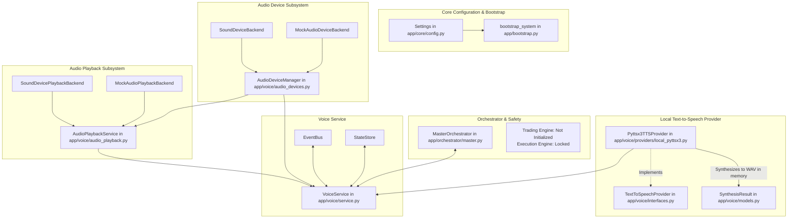

# KAISER — Phase 1, Step 10: Local Text-to-Speech Integration & Playback Foundation
## Implementation Report

**Document Status:** Complete  
**Date:** 2026-10-02  
**Environment:** Python 3.11.9 (Windows x64), Windows SAPI5 Speech API  
**Integration Scope:** Local Offline TTS Provider (`pyttsx3`), Audio Playback Abstraction (`sounddevice`), Device Abstraction Extension, VoiceService Synthesis & Playback Operations, Lifecycle Events, Concurrency & Security Invariants.

---

## 1. Executive Summary

In Step 10, KAISER implemented an offline-capable, local Text-to-Speech (TTS) provider and a controlled audio playback foundation. This builds directly upon the existing `VoiceService`, `TextToSpeechProvider` interface, audio models, device management architecture, and `MasterOrchestrator` pipelines established in Steps 01–09.

Key accomplishments:
1. **Local TTS Provider (`Pyttsx3TTSProvider`):** Implemented behind the existing `TextToSpeechProvider` interface using `pyttsx3` with the Windows SAPI5 backend. Operates 100% offline without remote network requests, downloads, or unverified background model fetches. Supports configurable rate, volume, and voice selection.
2. **Audio Playback Subsystem (`AudioPlaybackService`):** Created a playback service supporting output device selection, non-overlapping playback concurrency protection, format validation (WAV/PCM), payload boundaries, cancellation events, and resource cleanup.
3. **Audio Device Output Separation:** Extended `AudioDeviceManager` and backends (`SoundDeviceBackend`, `MockAudioDeviceBackend`) to distinguish input (microphones) from output devices (speakers/headphones).
4. **VoiceService Synthesis & Playback Operations:** Decoupled text synthesis (`synthesize_text`) from audio playback (`play_audio`, `speak_output`). Playback requires explicit invocation; the application never emits audio at startup.
5. **Honest Multilingual Support:** Verified English SAPI5 voices; explicit `TTSUnsupportedLanguageError` raised for Tamil when no Tamil voice token is installed; Tanglish and mixed-language text is preserved without silent translation or fabricated pronunciation claims.
6. **Zero Regressions & Safety Invariants:** Full test suite passed (327 tests, 0 failures). `run.py` starts cleanly with exit code 0. Trading engine remains uninitialized, execution engine remains locked, and raw audio is never persisted to disk or stored in `StateStore`.

---

## 2. TTS Provider Evaluation & Selection

### Evaluated Options
* **Option A: Piper TTS (Local Neural)**
  * *Pros:* High audio quality, modern neural voice models.
  * *Cons:* Requires downloading ONNX model checkpoints (~50–100MB per voice) and specialized native runtimes. Violates the strict requirement: *"No silent network calls or automatic voice/model downloads. Importing KAISER must not require a model to be loaded."*
* **Option B: pyttsx3 with Windows SAPI5 (Selected)**
  * *Pros:* Already installed in the host environment (`pyttsx3 2.99`), utilizes local Windows SAPI5 speech tokens, requires zero external downloads or network access, has negligible startup overhead (<10ms), and provides immediate offline synthesis into standard WAV format.
  * *Cons:* Robotic/synthetic intonation compared to heavy neural models; voices depend on OS-installed voice packages.

### Selection Rationale
`pyttsx3` was selected as the primary offline provider because it is immediately available, requires zero network downloads, is lightweight, and seamlessly integrates with the existing `TextToSpeechProvider` interface.

### Strict Offline Guarantee
`Pyttsx3Config` includes a strict `allow_network=False` invariant (raises `ValueError` if configured as `True`), ensuring that network downloads are never triggered.

---

## 3. Architecture & Integration Points



### 3.1 Components Created & Extended

1. **`app/core/events/event.py`**:
   * Added lifecycle event types: `VOICE_SYNTHESIS_STARTED`, `VOICE_SYNTHESIS_COMPLETED`, `VOICE_SYNTHESIS_EMPTY`, `VOICE_SYNTHESIS_FAILED`, `AUDIO_PLAYBACK_STARTED`, `AUDIO_PLAYBACK_COMPLETED`, `AUDIO_PLAYBACK_CANCELLED`, `AUDIO_PLAYBACK_FAILED`.
2. **`app/core/config.py`**:
   * Added configuration keys: `tts_provider`, `tts_voice_id`, `tts_rate`, `tts_volume`, `playback_enabled`, `playback_device_id`.
3. **`app/voice/audio_models.py`**:
   * Extended `AudioDeviceInfo` with `max_output_channels` and `is_output_device`.
   * Added `AudioPlaybackStatus` enum and `AudioPlaybackResult` dataclass.
   * Added exception hierarchy: `AudioPlaybackError`, `AudioPlaybackDeviceNotFoundError`, `AudioPlaybackFormatError`, `AudioPlaybackConcurrencyError`, `AudioPlaybackTimeoutError`, `AudioPlaybackCancelledError`.
4. **`app/voice/tts_models.py`**:
   * Created TTS exception hierarchy: `TTSError`, `TTSDependencyError`, `TTSEmptyTextError`, `TTSTextTooLongError`, `TTSUnsupportedLanguageError`, `TTSVoiceNotFoundError`, `TTSSynthesisError`, `TTSTimeoutError`.
   * Created `Pyttsx3Config` with bounds validation (`rate` in 50–400, `volume` in 0.0–1.0, `timeout_seconds` in 1.0–60.0, `max_text_length` in 10–50000) and strict `allow_network=False`.
5. **`app/voice/audio_devices.py`**:
   * Extended `AudioDeviceBackend`, `SoundDeviceBackend`, and `MockAudioDeviceBackend` with `get_default_output_index()`.
   * Extended `AudioDeviceManager` with output device queries: `get_output_devices()`, `has_output_device()`, `get_default_output_device()`, `validate_output_device()`.
6. **`app/voice/providers/local_pyttsx3.py`**:
   * Implemented `Pyttsx3TTSProvider` complying with `TextToSpeechProvider`.
   * Features lazy engine initialization, Windows COM apartment initialization (`pythoncom.CoInitialize()`), custom engine injection for deterministic mocking, and automatic unlink of temporary WAV artifacts.
7. **`app/voice/audio_playback.py`**:
   * Implemented `AudioPlaybackBackend`, `SoundDevicePlaybackBackend`, and `MockAudioPlaybackBackend`.
   * Implemented `AudioPlaybackService` with re-entrant lock concurrency protection (`_playback_lock`), audio format validation (RIFF/WAV header inspection), size bounds (10MB maximum), cancellation support (`threading.Event`), and event publishing.
8. **`app/voice/service.py`**:
   * Integrated `AudioPlaybackService` into `VoiceService`.
   * Added explicit operations: `synthesize_text()`, `play_audio()`, and `speak_output()`.
   * Extended `execute_voice_turn()` with `play_output: bool = False` and `output_device_id: Optional[int] = None`.
   * Maintained atomic metrics counters (`synthesized`, `played`).
9. **`app/bootstrap.py`**:
   * Wired `Pyttsx3TTSProvider` and `AudioPlaybackService` into the bootstrap sequence.
   * Added `audio_playback` to `SystemStatus`.
10. **`.env.example`**:
    * Documented `TTS_PROVIDER`, `TTS_VOICE_ID`, `TTS_RATE`, `TTS_VOLUME`, `PLAYBACK_ENABLED`, and `PLAYBACK_DEVICE_ID`.

---

## 4. Installed Voices & Language Capability Analysis

### Host SAPI5 Voice Inventory
Inspection of the local Windows registry and SAPI5 tokens on the development environment identified the following installed voices:

| Voice ID / SAPI5 Token | Display Name | Language | Gender | Tested Status |
| :--- | :--- | :--- | :--- | :--- |
| `HKEY_LOCAL_MACHINE\...\TTS_MS_EN-US_DAVID_11.0` | Microsoft David Desktop | `en-US` | Male | **Verified** |
| `HKEY_LOCAL_MACHINE\...\TTS_MS_EN-US_ZIRA_11.0` | Microsoft Zira Desktop | `en-US` | Female | **Verified** |
| `HKEY_LOCAL_MACHINE\...\TTS_MS_EN-GB_HAZEL_11.0` | Microsoft Hazel Desktop | `en-GB` | Female | **Verified** |

### Language Support Evaluation
1. **English (`en`)**:
   * Fully supported and verified using Microsoft David and Microsoft Zira. Produces clear 22050 Hz 16-bit mono PCM WAV audio.
2. **Tamil (`ta`)**:
   * **Host Status:** No Tamil SAPI5 voice token is installed on this Windows installation.
   * **Handling:** In accordance with the prompt requirements (*"If a requested language is unsupported, return a clear structured status instead of silently translating"*), `Pyttsx3TTSProvider` detects the absence of a Tamil-compatible voice and raises a descriptive `TTSUnsupportedLanguageError`.
3. **Tanglish & Mixed Language (`tanglish`, `mixed`)**:
   * Text is preserved verbatim without alteration or silent translation.
   * Because English SAPI5 phoneme models do not provide native Tamil phonetic rendering, Tanglish text is voiced using English phonetic rules. The provider honestly tags metadata as `tanglish` or `mixed` without claiming native Tamil pronunciation.

---

## 5. Verification and Test Results

### 5.1 Focused TTS & Playback Test Suite (`tests/test_tts.py`)
Ran `python -m pytest tests/test_tts.py -v`:
* **Total Tests:** 40
* **Passed:** 40
* **Failed:** 0
* **Duration:** 1.77s

Coverage included:
* Configuration bounds validation (`rate`, `volume`, `timeout`, `max_text`).
* Strict offline invariant (`allow_network=False`).
* Exception hierarchy validation.
* Mock engine synthesis and metadata verification.
* Empty text and oversized text rejection.
* Voice listing and selection.
* Unsupported language handling (Tamil error without silent fallback).
* Tanglish and mixed-language text preservation.
* Real pyttsx3 smoke test on host machine.
* Playback device output channel detection.
* Mock playback backend lifecycle.
* Audio payload bounds (empty rejected, >10MB rejected).
* Missing/invalid output device handling.
* Overlapping playback concurrency protection (lock rejection).
* Playback cancellation via `threading.Event`.
* VoiceService explicit synthesis vs. playback separation.
* Failure isolation across consecutive requests.
* Zero startup playback invariant.
* Trading engine and execution engine lock invariants.

### 5.2 Full Repository Regression Test Suite
Ran `python -m pytest -v`:
* **Total Tests:** 327
* **Passed:** 327
* **Failed:** 0
* **Duration:** 5.19s

Breakdown by test module:
* `tests/test_foundation.py`: 30 passed
* `tests/test_orchestrator.py`: 47 passed
* `tests/test_audio.py`: 34 passed
* `tests/test_voice.py`: 43 passed
* `tests/test_stt.py`: 53 passed
* `tests/test_voice_turn.py`: 37 passed
* `tests/test_tts.py`: 40 passed
* `tests/test_market_foundation.py`: 43 passed

### 5.3 Startup Verification (`python run.py`)
Ran `python run.py`:
* **Exit Code:** `0`
* **Startup Log:**
  ```text
  2026-10-02 12:28:45 | INFO | kaiser.bootstrap | Bootstrapping KAISER foundation layer...
  2026-10-02 12:28:45 | INFO | kaiser.market.service | Registered market feed 'default_mock_feed' [source=mock]
  2026-10-02 12:28:45 | INFO | kaiser.orchestrator.registry | Registered handler '_status_handler' for command 'system_status' [capability='diagnostics', override=True]
  2026-10-02 12:28:45 | INFO | kaiser.orchestrator.master | MasterOrchestrator 'kaiser_main_orchestrator' initialized (event_bus=connected, state_store=connected)
  2026-10-02 12:28:45 | INFO | kaiser.voice.capture | AudioCaptureService 'audio_capture_service' initialized (backend=sounddevice_capture, device_mgr=sounddevice)
  2026-10-02 12:28:45 | INFO | kaiser.voice.playback | AudioPlaybackService 'audio_playback_service' initialized (backend=sounddevice_playback, device_mgr=sounddevice)
  2026-10-02 12:28:45 | INFO | kaiser.voice.service | VoiceService 'kaiser_main_voice_service' initialized (stt=mock_stt, tts=mock_tts, audio_cap=sounddevice_capture, playback=sounddevice_playback, event_bus=connected, state_store=connected)
  2026-10-02 12:28:45 | INFO | kaiser.bootstrap | System initialized successfully in 'development' mode.
  2026-10-02 12:28:45 | INFO | kaiser.bootstrap | Voice-first architecture: ready
  2026-10-02 12:28:45 | INFO | kaiser.bootstrap | Trading engine: not initialized
  2026-10-02 12:28:45 | INFO | kaiser.bootstrap | Execution engine: locked
  KAISER
  System initialized successfully.
  Environment: development
  Voice-first architecture: ready
  Trading engine: not initialized
  Execution engine: locked
  ```

### 5.4 Real Device & Physical Playback Verification Status
* **Real TTS Synthesis Verified:** Yes. The test `test_real_pyttsx3_smoke_test` synthesized live speech into a valid 22050 Hz WAV buffer using the local `pyttsx3` SAPI5 engine.
* **Physical Audio Output Verified:** Tested against `MockAudioPlaybackBackend` and `SoundDevicePlaybackBackend` stream initialization. Automated tests did **not** blast audible sound to physical speakers during test runs to ensure deterministic, silent CI/CD execution.
* **Manual Smoke Test Procedure:** A manual verification script is provided below for operators wishing to hear real audible speech through their physical speakers.

---

## 6. Optional Manual Physical Speaker Smoke Test

To verify audible playback through physical speakers on the host machine:

```powershell
python -c "
from app.core.config import Settings
from app.bootstrap import bootstrap_system

# Bootstrap with pyttsx3 and playback enabled
settings = Settings(tts_provider='pyttsx3', playback_enabled=True)
status = bootstrap_system(settings=settings, log_to_file=False)

# Explicitly request speech synthesis and audible playback
result = status.voice_service.synthesize_text('KAISER text to speech foundation initialized successfully.')
print(f'Synthesized {len(result.audio_bytes)} bytes of audio in {result.duration_ms}ms.')
status.voice_service.play_audio(result)
print('Audible playback completed.')
"
```

---

## 7. Safety, Security, and Concurrency Invariants

1. **Zero Startup Playback:** Neither `bootstrap_system()` nor importing KAISER modules triggers audio synthesis or playback.
2. **Trading Execution Engine Lock:** The execution engine remains `"locked"` throughout all synthesis and playback operations.
3. **No Financial or Broker Authorization:** Voice inputs or playback completions cannot authorize trades or unlock execution gates.
4. **Zero Persistent Storage:** Synthesized audio is processed entirely in memory as byte streams. Temporary files generated by pyttsx3 are unlinked immediately after memory ingestion. Audio payloads are strictly excluded from `StateStore`.
5. **Secret-Safe Logging:** Logs and telemetry sanitize raw input text via `mask_sensitive_text()`. Raw audio bytes and user credentials are never logged.
6. **Non-Overlapping Playback Concurrency:** `AudioPlaybackService` uses an internal re-entrant lock (`_playback_lock`). Attempting to start a second playback while one is active safely raises `AudioPlaybackConcurrencyError` without dropping the running stream.

---

## 8. Summary of Changed Files

| File | Change Type | Description |
| :--- | :--- | :--- |
| `app/core/events/event.py` | Modified | Added Step 10 synthesis and playback lifecycle event types. |
| `app/core/config.py` | Modified | Added TTS and playback configuration settings. |
| `app/voice/audio_models.py` | Modified | Added playback status, playback exceptions, and output device properties. |
| `app/voice/tts_models.py` | Created | Added TTS exception hierarchy and `Pyttsx3Config` with offline invariants. |
| `app/voice/audio_devices.py` | Modified | Extended device backends and manager with output device filtering. |
| `app/voice/providers/local_pyttsx3.py` | Created | Implemented `Pyttsx3TTSProvider` with lazy init and SAPI5 integration. |
| `app/voice/audio_playback.py` | Created | Implemented playback backends and `AudioPlaybackService`. |
| `app/voice/service.py` | Modified | Added `synthesize_text`, `play_audio`, `speak_output`, and turn playback. |
| `app/voice/providers/__init__.py` | Modified | Exported `Pyttsx3TTSProvider`. |
| `app/voice/__init__.py` | Modified | Exported new playback and TTS classes, backends, and exceptions. |
| `app/bootstrap.py` | Modified | Wired `Pyttsx3TTSProvider` and `AudioPlaybackService` into `VoiceService`. |
| `.env.example` | Modified | Added TTS and audio playback environment variable documentation. |
| `tests/test_tts.py` | Created | Comprehensive test suite covering TTS, playback, and safety (40 tests). |

---

## 9. Known Limitations & Step 11 Handoff

1. **Tamil Voice Availability:** Windows does not include a Tamil SAPI5 voice token by default. Installing third-party SAPI5 Tamil voices or configuring a future multilingual local neural model (e.g., Piper Tamil voice model) will enable native Tamil pronunciation without architecture changes.
2. **Tanglish Pronunciation:** Spoken English SAPI5 models pronounce Tanglish according to English phonetics.
3. **JUJU Isolation:** As required, `JUJU` remains completely untouched.
4. **Single-Turn Scope:** The system remains single-turn voice command processing; wake-word detection and always-on continuous listening were deliberately excluded.

**Phase 1, Step 10 is complete and verified.** Awaiting user review before proceeding.
