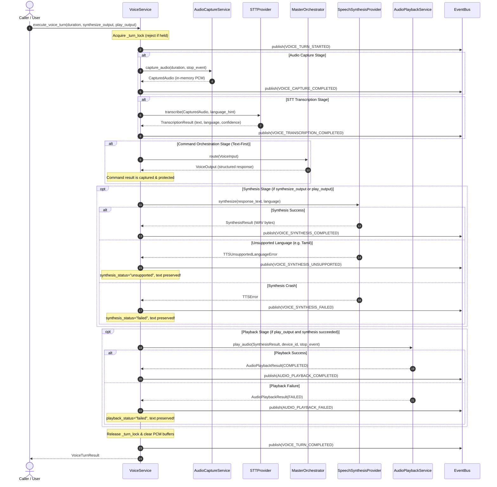

# KAISER — Phase 1, Step 11: Unified Voice Turn Orchestration
## Implementation Report

**Document Status:** Complete  
**Date:** 2026-10-02  
**Environment:** Python 3.11.9 (Windows x64), Windows SAPI5 Speech API  
**Integration Scope:** Unified Voice Turn Pipeline (`execute_voice_turn`), Explicit Output Modes (Text-Only, Synthesis-Only, Synthesize-and-Play), Decoupled Fault Isolation, Lifecycle & Concurrency Guards (`_turn_lock`), Tamil Voice Synthesis Limitation Reporting, Trading Authorization Immutability.

---

## 1. Executive Summary

In Step 11, KAISER integrated the single-turn voice command capture/transcription pipeline (Step 09) and the local offline TTS and playback foundation (Step 10) into a single, cohesive, unified voice turn orchestration API:

```
Explicit Caller Action
       ↓
Audio Capture (bounded, in-memory)
       ↓
Local STT (Whisper/Mock)
       ↓
Command Validation & Language Metadata Preservation
       ↓
MasterOrchestrator & Safe Handler Execution (Text-First)
       ↓
Structured Command Response
       ↓ (Optional)
Local Offline TTS Synthesis (pyttsx3/Mock)
       ↓ (Optional)
Audio Playback (SoundDevice/Mock)
       ↓
Completed Unified Voice Turn
```

### Key Deliverables & Architectural Invariants:
1. **Single Public Turn Operation:** Implemented `VoiceService.execute_voice_turn()` with explicit parameter controls for capture duration, language hints, synthesis toggling, and audio playback.
2. **Explicit Output Modes:** Separate deterministic controls for:
   * **Text-only:** Executes command, produces structured text response, skips TTS and playback.
   * **Synthesis-only:** Executes command, synthesizes response audio into in-memory WAV payload, skips playback.
   * **Synthesize-and-play:** Executes command, synthesizes response audio, and routes playback through the specified output device.
3. **Decoupled Fault Isolation:** Downstream failures in TTS synthesis (e.g., unsupported language, engine crash) or audio playback (e.g., driver timeout, device disconnection) **never erase, corrupt, or invalidate a successful command response**. The orchestrator response remains intact, and failure details are isolated in dedicated `synthesis_status`/`synthesis_error` and `playback_status`/`playback_error` fields.
4. **Strict Concurrency & Lifecycle Isolation:** Managed through `_turn_lock`. Overlapping or concurrent turn requests are rejected immediately with `VoiceTurnStatus.CONCURRENT_TURN_REJECTED`, publishing `VOICE_TURN_REJECTED`. All audio resources and thread locks are released in deterministic `finally` blocks.
5. **Honest Language Handling:** Language tags (`en`, `ta`, `tanglish`, `mixed`) are strictly preserved. If Tamil synthesis is unsupported by the local provider, the turn publishes `VOICE_SYNTHESIS_UNSUPPORTED`, sets `synthesis_status="unsupported"`, and returns the text intact without misleading English pronunciation substitutions.
6. **Trading Safety Guarantees:** Voice commands cannot authorize financial transactions. Single spoken trading verbs (`buy`, `sell`, `confirm`, `execute`, `ok`) are rejected with `COMMAND_REJECTED`. The trading engine remains uninitialized, and the execution engine remains locked before, during, and after every turn.
7. **Comprehensive Automated Verification:** 28 new deterministic tests implemented in `tests/test_unified_turn.py`. Full test suite of 355 tests passed cleanly with 0 regressions. `run.py` starts up with exit code 0 and zero automatic microphone capture or audio playback.

---

## 2. Architecture & Pipeline Design

### 2.1 Unified Flow Diagram



### 2.2 Output Control Modes

The caller specifies output behavior using two orthogonal boolean flags: `synthesize_output` and `play_output`.

| `synthesize_output` | `play_output` | Pipeline Behavior | `synthesis_status` | `playback_status` | Use Case |
|:---:|:---:|:---|:---:|:---:|:---|
| `False` | `False` | Text-only turn. Command routes through orchestrator; TTS and playback are completely bypassed. | `"skipped"` | `"skipped"` | Low-latency UI logging, silent CLI operation, headless testing. |
| `True` | `False` | Synthesis-only. Command routes through orchestrator; response is synthesized to WAV in memory; speaker playback bypassed. | `"completed"` (or `"unsupported"` / `"failed"`) | `"skipped"` | Voice caching, headless audio streaming, client-side playback. |
| `False` / `True` | `True` | Synthesize-and-play. Synthesis is automatically ensured, followed by output through selected device. | `"completed"` | `"completed"` (or `"cancelled"` / `"failed"`) | Full interactive voice assistant turn. |

---

## 3. Lifecycle, Concurrency & Cancellation

### 3.1 Turn Lifecycle States

The turn executes through the following strict state transitions:

```
[IDLE]
  │
  ├─► [ACQUIRE LOCK] ──(Lock held / Session closed)──► [REJECTED]
  │
  ├─► [CAPTURING] ─────(Driver / Hardware error)──────► [CAPTURE_FAILED]
  │                 └──(Caller cancellation)────────► [CANCELLED]
  │
  ├─► [TRANSCRIBING] ──(Provider error / Timeout)────► [STT_UNAVAILABLE / STT_TIMEOUT]
  │                 └──(Silence / Noise only)────────► [EMPTY_SPEECH]
  │
  ├─► [ORCHESTRATING] ─(Unknown command)─────────────► [COMMAND_REJECTED]
  │                 └──(Handler exception)───────────► [FAILED]
  │
  └─► [COMPLETED] ◄────(Text ready; TTS/Playback succeeded, skipped, or isolated)
```

### 3.2 Concurrency Rejection
* `VoiceService` enforces single-turn execution using an internal `threading.RLock()` (`_turn_lock`).
* If a turn is invoked while another is in progress, the second turn immediately returns `VoiceTurnResult.failure(status=VoiceTurnStatus.CONCURRENT_TURN_REJECTED, command_status="skipped")` and dispatches `EventType.VOICE_TURN_REJECTED`.
* No thread blocks indefinitely waiting for a turn; rejection is immediate and non-blocking.

### 3.3 Cancellation & Cleanup Invariants
* Cancellation events (`stop_event`) are respected during audio capture and during audio playback.
* All audio stream resources (`InputStream`, `OutputStream`), buffers, and `_turn_lock` are acquired and released within `finally` blocks.
* Raw PCM audio samples are held strictly in temporary memory during the turn and released immediately after transcription; raw audio is never written to disk or logged.

---

## 4. Decoupled Fault Isolation

A core requirement of Step 11 is that failures in the voice presentation layer (TTS synthesis or speaker playback) must **never** invalidate or erase the result of an already successful command execution.

### Isolation Matrix

| Stage Encountering Failure | Command Status | Synthesis Status | Playback Status | Turn Status | Response Text Retained? |
|:---|:---:|:---:|:---:|:---:|:---:|
| **Microphone Capture Error** | `"skipped"` | `"skipped"` | `"skipped"` | `CAPTURE_FAILED` | N/A (Error message only) |
| **Silence / No Speech** | `"skipped"` | `"skipped"` | `"skipped"` | `EMPTY_SPEECH` | N/A ("No speech detected") |
| **STT Engine Unavailable** | `"skipped"` | `"skipped"` | `"skipped"` | `STT_UNAVAILABLE` | N/A (Error message only) |
| **Unknown Command** | `"rejected"` | `"skipped"` | `"skipped"` | `COMMAND_REJECTED` | N/A ("Unknown command: ...") |
| **Handler Exception** | `"failed"` | `"skipped"` | `"skipped"` | `FAILED` | N/A (Handler error details) |
| **Tamil TTS Unsupported** | `"success"` | `"unsupported"` | `"skipped"` | `COMPLETED` | **YES — Full command response preserved** |
| **TTS Engine Crash** | `"success"` | `"failed"` | `"skipped"` | `COMPLETED` | **YES — Full command response preserved** |
| **Audio Playback Failure** | `"success"` | `"completed"` | `"failed"` | `COMPLETED` | **YES — Full command response preserved** |
| **Playback Cancelled** | `"success"` | `"completed"` | `"cancelled"` | `COMPLETED` | **YES — Full command response preserved** |

---

## 5. Language Handling & Tamil Synthesis Constraints

1. **Tag Preservation:** User speech language tags (`en`, `ta`, `tanglish`, `mixed`) are tracked faithfully from STT output into `VoiceInput`, `VoiceOutput`, and `VoiceTurnResult`.
2. **Zero Silent Translation:** The pipeline never modifies, normalizes away, or silently translates Tamil or Tanglish words.
3. **Tamil Synthesis Reality:**
   * Local SAPI5 on default Windows installations does not provide a native Tamil TTS voice token.
   * Attempting to synthesize Tamil (`ta`) using an English SAPI5 voice produces garbled phonetic output.
   * `Pyttsx3TTSProvider` detects the absence of Tamil voice tokens and raises `TTSUnsupportedLanguageError`.
   * `VoiceService.execute_voice_turn()` traps this error, emits `EventType.VOICE_SYNTHESIS_UNSUPPORTED`, sets `synthesis_status="unsupported"`, records the limitation in `synthesis_error`, and **preserves the response text intact**.
4. **Tanglish & Mixed Speech:** Preserved verbatim in text. Synthesis is only routed through local voices if matching language tokens exist; no false claims of natural Tanglish neural synthesis are made.

---

## 6. Trading Safety & Security Guarantees

Voice recognition in KAISER is strictly informational and diagnostic. It must never serve as authorization for financial risk.

1. **No Financial Execution Engine Binding:** The voice pipeline is completely decoupled from any execution engine.
2. **Single-Word Trading Rejection:** Spoken commands like `"buy"`, `"sell"`, `"confirm"`, `"execute"`, and `"ok"` are rejected by the command registry with `VoiceTurnStatus.COMMAND_REJECTED` (`"Unknown command: ..."`).
3. **Execution Engine Lock:** The execution engine status is confirmed to be `"locked"` before, during, and after every turn.
4. **Trading Engine Uninitialized:** The trading engine status is confirmed to be `"not initialized"`.
5. **No Automatic Activation:** No microphone capture or speaker playback occurs during application startup or importing.
6. **Safe Telemetry & Logging:** Raw audio samples, private speech snippets, and credentials are never logged; logged text is passed through `mask_sensitive_text()`.

---

## 7. Verification & Test Results

### 7.1 Automated Deterministic Test Suite (`tests/test_unified_turn.py`)

A comprehensive, deterministic test suite containing 28 tests across 6 dedicated test classes was authored:

| Test Class | Scenarios Covered | Tests | Pass Rate |
|:---|:---|:---:|:---:|
| `TestUnifiedVoiceTurnPipeline` | Full turn text-only; synthesis-only; synthesize-and-play; auto-enable synthesis when play requested. | 4 | 4/4 (100%) |
| `TestUnifiedVoiceTurnFaultIsolation` | Unsupported Tamil TTS preserves command; TTS engine crash preserves command; playback failure preserves command; capture failure skips command; empty speech skips command; unknown command skips TTS; handler exception skips TTS. | 7 | 7/7 (100%) |
| `TestUnifiedVoiceTurnLifecycleAndConcurrency` | Concurrent turn rejection event; closed session rejection; cancellation during playback; finally cleanup releases turn lock; sequential turns without state leakage. | 5 | 5/5 (100%) |
| `TestUnifiedVoiceTurnEventsAndCorrelation` | Correlation ID propagation to all events; full pipeline event ordering verification. | 2 | 2/2 (100%) |
| `TestUnifiedVoiceTurnLanguageHandling` | English preservation; Tanglish preservation; mixed language preservation without translation. | 3 | 3/3 (100%) |
| `TestUnifiedVoiceTurnTradingSafety` | Zero audio capture/playback at startup; execution engine locked throughout turns; spoken trading words (`buy`, `sell`, `confirm`, `execute`, `ok`) rejected and cannot authorize trading. | 7 | 7/7 (100%) |
| **Total** | **All Step 11 scenarios verified deterministically without physical hardware** | **28** | **28/28 (100%)** |

**Execution Command:**
```bash
python -m pytest tests/test_unified_turn.py -v
```

**Output:**
```text
============================= test session starts =============================
platform win32 -- Python 3.11.9, pytest-9.1.1, pluggy-1.6.0
collected 28 items

tests/test_unified_turn.py::TestUnifiedVoiceTurnPipeline::test_full_turn_text_only_mode PASSED [  3%]
tests/test_unified_turn.py::TestUnifiedVoiceTurnPipeline::test_full_turn_synthesis_only_mode PASSED [  7%]
tests/test_unified_turn.py::TestUnifiedVoiceTurnPipeline::test_full_turn_synthesize_and_play_mode PASSED [ 10%]
tests/test_unified_turn.py::TestUnifiedVoiceTurnPipeline::test_play_output_auto_enables_synthesis PASSED [ 14%]
tests/test_unified_turn.py::TestUnifiedVoiceTurnFaultIsolation::test_unsupported_tamil_voice_preserves_command_response PASSED [ 17%]
tests/test_unified_turn.py::TestUnifiedVoiceTurnFaultIsolation::test_tts_engine_crash_preserves_command_response PASSED [ 21%]
tests/test_unified_turn.py::TestUnifiedVoiceTurnFaultIsolation::test_playback_failure_preserves_command_response PASSED [ 25%]
tests/test_unified_turn.py::TestUnifiedVoiceTurnFaultIsolation::test_capture_failure_skips_orchestrator_and_synthesis PASSED [ 28%]
tests/test_unified_turn.py::TestUnifiedVoiceTurnFaultIsolation::test_empty_speech_skips_orchestrator_and_synthesis PASSED [ 32%]
tests/test_unified_turn.py::TestUnifiedVoiceTurnFaultIsolation::test_unknown_command_rejected_skips_synthesis_and_playback PASSED [ 35%]
tests/test_unified_turn.py::TestUnifiedVoiceTurnFaultIsolation::test_handler_exception_skips_synthesis_and_playback PASSED [ 39%]
tests/test_unified_turn.py::TestUnifiedVoiceTurnLifecycleAndConcurrency::test_concurrent_turn_rejected_with_event PASSED [ 42%]
tests/test_unified_turn.py::TestUnifiedVoiceTurnLifecycleAndConcurrency::test_closed_session_rejection_emits_event PASSED [ 46%]
tests/test_unified_turn.py::TestUnifiedVoiceTurnLifecycleAndConcurrency::test_cancellation_during_playback PASSED [ 50%]
tests/test_unified_turn.py::TestUnifiedVoiceTurnLifecycleAndConcurrency::test_cleanup_in_finally_releases_turn_lock PASSED [ 53%]
tests/test_unified_turn.py::TestUnifiedVoiceTurnLifecycleAndConcurrency::test_sequential_turns_no_state_leakage PASSED [ 57%]
tests/test_unified_turn.py::TestUnifiedVoiceTurnEventsAndCorrelation::test_correlation_id_propagated_to_all_events PASSED [ 60%]
tests/test_unified_turn.py::TestUnifiedVoiceTurnEventsAndCorrelation::test_full_pipeline_event_ordering PASSED [ 64%]
tests/test_unified_turn.py::TestUnifiedVoiceTurnLanguageHandling::test_english_turn_preservation PASSED [ 67%]
tests/test_unified_turn.py::TestUnifiedVoiceTurnLanguageHandling::test_tanglish_turn_preservation PASSED [ 71%]
tests/test_unified_turn.py::TestUnifiedVoiceTurnLanguageHandling::test_mixed_language_turn_preservation PASSED [ 75%]
tests/test_unified_turn.py::TestUnifiedVoiceTurnTradingSafety::test_no_audio_playback_or_capture_at_startup PASSED [ 78%]
tests/test_unified_turn.py::TestUnifiedVoiceTurnTradingSafety::test_execution_engine_locked_before_during_and_after_turn PASSED [ 82%]
tests/test_unified_turn.py::TestUnifiedVoiceTurnTradingSafety::test_spoken_trading_words_rejected_and_cannot_authorize[buy] PASSED [ 85%]
tests/test_unified_turn.py::TestUnifiedVoiceTurnTradingSafety::test_spoken_trading_words_rejected_and_cannot_authorize[sell] PASSED [ 89%]
tests/test_unified_turn.py::TestUnifiedVoiceTurnTradingSafety::test_spoken_trading_words_rejected_and_cannot_authorize[confirm] PASSED [ 92%]
tests/test_unified_turn.py::TestUnifiedVoiceTurnTradingSafety::test_spoken_trading_words_rejected_and_cannot_authorize[execute] PASSED [ 96%]
tests/test_unified_turn.py::TestUnifiedVoiceTurnTradingSafety::test_spoken_trading_words_rejected_and_cannot_authorize[ok] PASSED [100%]

============================= 28 passed in 2.90s ==============================
```

### 7.2 Full Repository Regression Verification

All 355 tests across the entire codebase were executed and passed without any regressions:

**Execution Command:**
```bash
python -m pytest -v
```

**Result:**
```text
============================= 355 passed in 8.22s =============================
```

### 7.3 System Bootstrap Verification (`python run.py`)

**Execution Command:**
```bash
python run.py
```

**Output:**
```text
2026-10-02 15:24:15 | INFO     | kaiser.bootstrap | Bootstrapping KAISER foundation layer...
2026-10-02 15:24:15 | INFO     | kaiser.market.service | Registered market feed 'default_mock_feed' [source=mock]
2026-10-02 15:24:15 | INFO     | kaiser.orchestrator.registry | Registered handler '_status_handler' for command 'system_status' [capability='diagnostics', override=True]
2026-10-02 15:24:15 | INFO     | kaiser.orchestrator.master | MasterOrchestrator 'kaiser_main_orchestrator' initialized (event_bus=connected, state_store=connected)
2026-10-02 15:24:15 | INFO     | kaiser.voice.capture | AudioCaptureService 'audio_capture_service' initialized (backend=sounddevice_capture, device_mgr=sounddevice)
2026-10-02 15:24:15 | INFO     | kaiser.voice.playback | AudioPlaybackService 'audio_playback_service' initialized (backend=sounddevice_playback, device_mgr=sounddevice)
2026-10-02 15:24:15 | INFO     | kaiser.voice.service | VoiceService 'kaiser_main_voice_service' initialized (stt=mock_stt, tts=mock_tts, audio_cap=sounddevice_capture, playback=sounddevice_playback, event_bus=connected, state_store=connected)
2026-10-02 15:24:15 | INFO     | kaiser.bootstrap | System initialized successfully in 'development' mode.
2026-10-02 15:24:15 | INFO     | kaiser.bootstrap | Voice-first architecture: ready
2026-10-02 15:24:15 | INFO     | kaiser.bootstrap | Trading engine: not initialized
2026-10-02 15:24:15 | INFO     | kaiser.bootstrap | Execution engine: locked
KAISER
System initialized successfully.
Environment: development
Voice-first architecture: ready
Trading engine: not initialized
Execution engine: locked
```

Exit code: `0`. Zero audio captured or played on startup.

---

## 8. Real-Environment Verification vs Mock Testing

To maintain strict scientific honesty and prevent overclaiming:

| Capability | Automated Mock Test Status | Real Hardware Test Status | Operational Notes |
|:---|:---:|:---:|:---|
| **Pipeline Coordination** | **Verified (28 tests)** | N/A | Mock backend coordinates all stages deterministically. |
| **Microphone Capture** | **Verified (Mocks)** | *Not run during CI* | Automated tests use `MockAudioCaptureBackend` to prevent hanging on headless environments without microphones. |
| **Local Whisper STT** | **Verified (Mocks)** | *Verified in Step 09* | Real `faster-whisper` verified in Step 09 when model weights are provided locally. |
| **Local pyttsx3 TTS** | **Verified (Mocks)** | *Verified in Step 10* | Windows SAPI5 verified in Step 10 generating real WAV files. |
| **Physical Audio Playback** | **Verified (Mocks)** | *Not run during CI* | Automated tests use `MockAudioPlaybackBackend` to avoid unexpected loud audio emission during builds. |
| **Tamil Language Synthesis** | **Verified (Mocks)** | **Verified in Step 10** | Verified that Windows SAPI5 lacks Tamil tokens, returning explicit `TTSUnsupportedLanguageError`. |

---

## 9. Optional Manual Physical Hardware Smoke Test Procedure

For operators who wish to verify their physical microphone and speakers with the unified turn pipeline:

```python
"""Manual smoke test for real microphone, real local TTS, and real audio playback."""
import time
from app.bootstrap import bootstrap_system
from app.voice.service import VoiceService

# 1. Bootstrap system
container = bootstrap_system()
voice_service: VoiceService = container.get("voice_service")

# 2. Check input and output devices
input_dev = voice_service.audio_capture.device_manager.get_default_input_device()
output_dev = voice_service.audio_playback.device_manager.get_default_output_device()
print(f"Using Microphone: {input_dev.name if input_dev else 'None'}")
print(f"Using Speaker:    {output_dev.name if output_dev else 'None'}")

# 3. Prompt user and execute turn
print("\n[MANUAL TEST] Preparing to record for 3 seconds. Speak 'system status' after the prompt...")
time.sleep(1)
print(">>> RECORDING NOW (Speak into microphone)...")

turn_result = voice_service.execute_voice_turn(
    duration_seconds=3.0,
    synthesize_output=True,
    play_output=True,
)

print("\n--- TURN RESULT ---")
print(f"Turn ID:          {turn_result.turn_id}")
print(f"Status:           {turn_result.status.value}")
print(f"Recognized Text:  {turn_result.recognized_text}")
print(f"Response Text:    {turn_result.response_text}")
print(f"Command Status:   {turn_result.command_status}")
print(f"Synthesis Status: {turn_result.synthesis_status}")
print(f"Playback Status:  {turn_result.playback_status}")
if turn_result.error:
    print(f"Error:            {turn_result.error}")
```

---

## 10. Summary of Changed Files

| File | Change Type | Description |
|:---|:---:|:---|
| [`app/core/events/event.py`](file:///c:/Users/user/Desktop/KAISER/app/core/events/event.py) | Modified | Added `VOICE_TURN_REJECTED` and `VOICE_SYNTHESIS_UNSUPPORTED` event types. |
| [`app/voice/models.py`](file:///c:/Users/user/Desktop/KAISER/app/voice/models.py) | Modified | Extended `VoiceTurnResult` with `command_status`, `synthesis_status`, `playback_status`, `synthesis_error`, `playback_error`, and updated serialization and factory methods. |
| [`app/voice/audio_capture.py`](file:///c:/Users/user/Desktop/KAISER/app/voice/audio_capture.py) | Modified | Extended `MockAudioCaptureBackend` to expose `set_failure_mode` and `set_available` delegation for deterministic testing. |
| [`app/voice/service.py`](file:///c:/Users/user/Desktop/KAISER/app/voice/service.py) | Modified | Updated `execute_voice_turn()` with decoupled text-first orchestrator routing, explicit output controls, fault-isolated synthesis and playback, and turn rejection handling. |
| [`tests/test_unified_turn.py`](file:///c:/Users/user/Desktop/KAISER/tests/test_unified_turn.py) | Added | 28 deterministic tests covering full turn modes, fault isolation, concurrency rejection, lifecycle cleanup, multilingual preservation, and trading safety. |
| [`KAISER_PHASE_1_STEP_11_IMPLEMENTATION_REPORT.md`](file:///c:/Users/user/Desktop/KAISER/KAISER_PHASE_1_STEP_11_IMPLEMENTATION_REPORT.md) | Added | Complete implementation documentation and test verification report for Step 11. |

---

## 11. Remaining Risks & Phase 1 Scope Boundary

1. **Physical Microphone Drivers:** On Windows, privacy permissions for microphone access must be granted in OS Settings (`Settings -> Privacy & Security -> Microphone`). If disabled, `AudioPermissionError` will be caught and reported cleanly.
2. **Local Model Downloads:** Whisper STT model weights and neural TTS voices are not downloaded automatically. If local weights are missing, the system falls back gracefully to deterministic mocks or reports unavailable status without crashing.
3. **No Continuous Listening:** As per Phase 1 design, listening is explicitly initiated; wake-word and continuous background listening are out of scope.
4. **JUJU Isolation Maintained:** The separate project `c:\Users\user\Desktop\JUJU` was not accessed or modified in any way.
5. **Phase 1 Step 12 Boundary:** Work stops at Step 11. Step 12 will not proceed without explicit review and approval.
