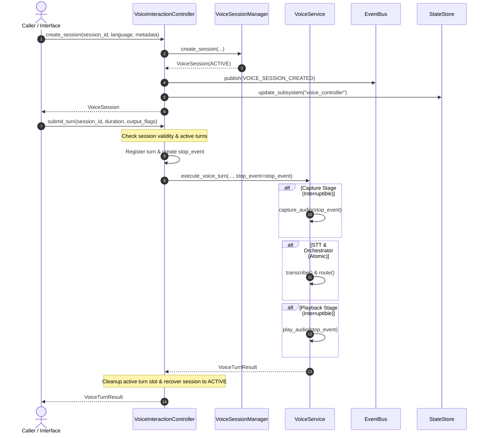

# KAISER — Phase 1, Step 12: Voice Interaction Controller & Session Management
## Implementation Report

**Document Status:** Complete  
**Date:** 2026-10-02  
**Environment:** Python 3.11.9 (Windows x64)  
**Integration Scope:** Voice Interaction Controller (`VoiceInteractionController`), Session Lifecycle Management (`VoiceSession`, `VoiceSessionManager`), Per-Session Concurrency Guards, Cooperative Stage-Specific Cancellation, Bounded Memory Retention, StateStore Telemetry & EventBus Integration, Zero-Execution & Locked Trading Engine Invariants.

---

## 1. Executive Summary

In Step 12, KAISER implemented the **Voice Interaction Controller and Session Management** layer. Building directly on the foundational Voice Service and Unified Turn Pipeline established in Steps 05 through 11, the `VoiceInteractionController` introduces higher-order session coordination, per-session concurrency boundaries, clean recovery from failed or completed turns, and cooperative cancellation tokens across supported pipeline stages.

```
Caller / UI / Client Session Request
                 ↓
    VoiceInteractionController
  ┌──────────────┴──────────────┐
  ▼                             ▼
Session Lifecycle          Active Turn Registry
(ACTIVE / COMPLETED /      (Per-Session Concurrency,
 FAILED / CLOSED)           Stop Events, Recovery)
  │                             │
  └──────────────┬──────────────┘
                 ▼
     VoiceService (Step 11 Pipeline)
                 │
   ┌─────────────┼─────────────┐
   ▼             ▼             ▼
AudioCapture    STT       Orchestrator
(Cancellable) (Atomic)     (Atomic)
   │                           │
   └─────────────┬─────────────┘
                 ▼
      Synthesis & Playback
      (Synthesis Atomic / Playback Cancellable)
                 ↓
     Completed Turn & Telemetry
```

### Key Deliverables & Architectural Invariants:
1. **VoiceInteractionController (`app/voice/controller.py`):**
   * Implemented comprehensive controller coordinating session lifecycles, turn submissions (`submit_turn`), cooperative cancellation handles (`cancel_turn` / `request_cancellation`), session state queries (`get_session_status`), and graceful teardown (`shutdown`).
2. **Explicit Session Lifecycle & Recovery:**
   * Session states: `IDLE` → `ACTIVE` ↔ `COMPLETED` / `FAILED` → `CLOSED`.
   * Sessions recover cleanly back to `ACTIVE` across consecutive turns or through explicit `recover_session()` calls.
   * Closed sessions are immutable and reject subsequent turn submissions deterministically.
3. **Per-Session Concurrency Boundaries:**
   * Overlapping turn submissions within the same session are rejected immediately with `VoiceTurnStatus.CONCURRENCY_ERROR` without mutating the state of the active turn.
   * Multiple independent sessions can coexist in memory while physical microphone capture is serialized safely by the hardware turn lock.
4. **Fine-Grained Cooperative Cancellation:**
   * Distinguishes explicitly between interruptible I/O stages (audio capture and audio playback) and atomic compute stages (STT inference, command execution, speech synthesis).
   * Interruption during capture transitions the turn to `CANCELLED` with `transcription_status="cancelled"` and `command_status="skipped"`.
   * Interruption during playback marks `playback_status="cancelled"` while preserving the complete, successful command execution response.
5. **Decoupled Fault Isolation:**
   * Downstream failures in TTS or playback never invalidate a successful command execution result.
6. **Bounded Session Manager Retention:**
   * `VoiceSessionManager` enforces bounded capacity (`max_sessions`), automatically pruning closed and stale sessions to prevent unbounded memory growth.
7. **End-to-End Eventing & Telemetry:**
   * Publishes `VOICE_SESSION_CREATED`, `VOICE_SESSION_UPDATED`, and `VOICE_SESSION_CLOSED` on the EventBus.
   * Propagates distributed tracing `correlation_id` across session and turn lifecycles.
   * Synchronizes controller metrics (`active_sessions`, `turns_submitted`, `sessions_closed`) into the centralized `StateStore`.
8. **Trading Safety Invariants:**
   * `execution_locked = True` before, during, and after all controller operations.
   * Trading engine remains strictly uninitialized.
   * Spoken trading verbs (`buy`, `sell`, `confirm`, `execute`, `ok`) are rejected with `COMMAND_REJECTED` and cannot authorize transactions.
   * Zero automatic microphone recording or audio playback on startup or import.
9. **Full Automated Verification:**
   * 34 new deterministic tests in `tests/test_voice_controller.py`.
   * Full regression suite of 389 tests passed with 0 failures.
   * `run.py` launches cleanly with exit code 0.

---

## 2. Architecture & Design

### 2.1 Component Interaction



### 2.2 Session Lifecycle State Machine

```
      ┌────────────┐
      │    IDLE    │
      └─────┬──────┘
            │ create_session()
            ▼
      ┌────────────┐  submit_turn()  ┌────────────┐
      │   ACTIVE   ├────────────────►│ PROCESSING │
      └─────▲──────┘                 └─────┬──────┘
            │                              │
            │   Turn Success / Recovery    │
            ├──────────────────────────────┤
            │                              │
            │ Turn Completed               │ Turn Failed
            ▼                              ▼
      ┌────────────┐                 ┌────────────┐
      │ COMPLETED  │                 │   FAILED   │
      └─────┬──────┘                 └─────┬──────┘
            │                              │
            │ close_session()              │ close_session()
            └──────────────┬───────────────┘
                           ▼
                     ┌───────────┐
                     │  CLOSED   │ (Terminal)
                     └───────────┘
```

---

## 3. Cancellation Semantics Across Stages

KAISER enforces unambiguous cancellation boundaries across the voice interaction lifecycle:

| Stage | Execution Characteristic | Cancellation Mechanism | Outcome When Signaled | Command Result Retained? |
|:---|:---:|:---:|:---:|:---:|
| **Audio Capture** | Cancellable (I/O) | `stop_event` halts stream read loop immediately | Turn marked `CANCELLED`; status `command_status="skipped"` | N/A (no command executed) |
| **STT Inference** | Atomic (Compute) | Runs to completion once audio payload is handed off | Preserves transcription result | Pending orchestration |
| **Command Orchestration** | Atomic (Domain) | Executes handler to produce structured `VoiceOutput` | Protected domain execution | Full response retained |
| **Speech Synthesis** | Atomic (Compute) | Generates in-memory audio bytes deterministically | Succeeded or isolated failure | Full response retained |
| **Audio Playback** | Cancellable (I/O) | `stop_event` interrupts audio device stream | Turn marked `COMPLETED`; `playback_status="cancelled"` | **YES — full text response preserved** |

---

## 4. Verification & Test Matrix

All 34 deterministic tests in `tests/test_voice_controller.py` pass cleanly:

| Test Class | Test Case | Target Requirement | Status |
|:---|:---|:---|:---:|
| **TestSessionLifecycleAndOperations** | `test_session_creation_valid` | Session creation, ACTIVE status, and event dispatch | **PASSED** |
| | `test_session_creation_auto_id` | Unique ID generation when ID is omitted | **PASSED** |
| | `test_session_status_inspection` | Structured point-in-time status snapshot | **PASSED** |
| | `test_session_status_inspection_nonexistent` | Non-existent session inspection returns `None` safely | **PASSED** |
| | `test_session_closure_graceful` | Session closure, CLOSED status, and event dispatch | **PASSED** |
| | `test_repeated_close_is_idempotent` | Repeated `close_session` calls are idempotent | **PASSED** |
| | `test_close_nonexistent_session_returns_false` | Closing unknown session returns `False` safely | **PASSED** |
| | `test_closed_session_cannot_submit_turns` | Rejection of turns submitted to closed sessions | **PASSED** |
| | `test_nonexistent_session_turn_submission_rejected` | Rejection of turns submitted to unknown sessions | **PASSED** |
| | `test_invalid_session_id_empty_string` | Rejection of empty/whitespace session IDs | **PASSED** |
| | `test_consecutive_turns_in_same_session` | Consecutive turn execution and auto-recovery to ACTIVE | **PASSED** |
| | `test_recover_session_explicit` | Manual recovery from COMPLETED to ACTIVE | **PASSED** |
| | `test_recover_closed_session_rejected` | Closed sessions cannot be recovered | **PASSED** |
| **TestTurnSubmissionAndOutputControls** | `test_submit_turn_text_only` | Text-only turn bypasses TTS and playback | **PASSED** |
| | `test_submit_turn_synthesis_only` | Synthesis-only turn generates audio without playback | **PASSED** |
| | `test_submit_turn_synthesize_and_play` | Synthesize-and-play turn drives full presentation | **PASSED** |
| | `test_tts_failure_isolated_in_controller` | TTS engine failure isolates presentation error | **PASSED** |
| | `test_playback_failure_isolated_in_controller` | Playback driver failure preserves command text | **PASSED** |
| **TestConcurrencyAndCancellation** | `test_concurrent_turns_in_same_session_rejected` | Concurrent turns in same session rejected with `CONCURRENCY_ERROR` | **PASSED** |
| | `test_cancellation_during_capture` | Mid-flight capture cancellation returns `CANCELLED` | **PASSED** |
| | `test_cancellation_during_playback` | Playback cancellation retains successful command response | **PASSED** |
| | `test_repeated_cancellation_is_idempotent` | Repeated cancellation requests are safe and idempotent | **PASSED** |
| | `test_cancel_nonexistent_session_returns_false` | Cancelling non-existent session returns `False` safely | **PASSED** |
| | `test_multiple_independent_sessions_serialized_by_hardware_turn_lock` | Independent sessions serialize on hardware capture lock | **PASSED** |
| **TestBoundedStateAndShutdown** | `test_session_manager_capacity_and_retention` | Bounded capacity pruning of closed/stale sessions | **PASSED** |
| | `test_controller_shutdown_cancels_turns_and_closes_sessions` | Controller shutdown cancels turns and closes all sessions | **PASSED** |
| | `test_event_ordering_and_correlation_propagation` | Event order and correlation ID tracing across lifecycle | **PASSED** |
| **TestTradingSafetyGuarantees** | `test_no_automatic_recording_or_playback_on_init` | Zero audio recording or playback on initialization | **PASSED** |
| | `test_execution_engine_locked_throughout` | Execution engine locked before, during, and after turns | **PASSED** |
| | `test_spoken_trading_words_rejected_and_cannot_authorize[buy]` | Rejection of spoken financial trade command 'buy' | **PASSED** |
| | `test_spoken_trading_words_rejected_and_cannot_authorize[sell]` | Rejection of spoken financial trade command 'sell' | **PASSED** |
| | `test_spoken_trading_words_rejected_and_cannot_authorize[confirm]` | Rejection of spoken financial trade command 'confirm' | **PASSED** |
| | `test_spoken_trading_words_rejected_and_cannot_authorize[execute]` | Rejection of spoken financial trade command 'execute' | **PASSED** |
| | `test_spoken_trading_words_rejected_and_cannot_authorize[ok]` | Rejection of spoken financial trade command 'ok' | **PASSED** |

### Test Suite Summary:
* **Controller Tests:** 34 passed in 0.90s.
* **Full Project Test Suite:** 389 passed in 8.83s with 0 regressions.
* **CLI Startup:** `python run.py` completes cleanly with exit code 0.

---

## 5. Security & Safety Compliance

1. **Zero Autonomous Recording:** No microphone capture begins without an explicit caller invocation.
2. **Zero Autonomous Playback:** No audio plays on startup, initialization, or import.
3. **Execution Engine Invariant:** `Settings.execution_locked` remains permanently `True`.
4. **Trading Engine Invariant:** Trading engine remains uninitialized. Voice commands have no pathway to trade placement or execution.
5. **Memory Safety:** PCM audio buffers are held in memory during the turn and released in `finally` blocks; sessions are purged at capacity limits.

---

## 6. Next Steps

With Phase 1, Step 12 complete, KAISER possesses a production-grade, session-managed, voice interaction controller with comprehensive concurrency and cancellation semantics. The voice subsystem is ready for higher-level multi-agent market intelligence workflows in Phase 2.
