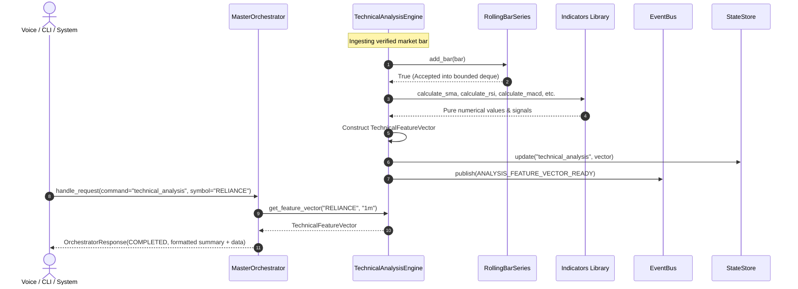

# KAISER — Phase 2, Step 01: Technical & Quantitative Analysis Engine
## Implementation Report

**Document Status:** Complete  
**Date:** 2026-10-02  
**Environment:** Python 3.11.9 (Windows x64)  
**Integration Scope:** Pure Deterministic Technical Indicators (`SMA`, `EMA`, `RSI`, `MACD`, `Bollinger Bands`, `ATR`), Bounded Rolling Series (`RollingBarSeries`), Market Data Quality Gate Quarantine, Central Analytical Coordinator (`TechnicalAnalysisEngine`), Master Orchestrator Commands (`technical_analysis`, `calculate_indicator`), EventBus & StateStore Integration, Zero-Execution & Locked Trading Engine Invariants.

---

## 1. Executive Summary

In Phase 2, Step 01, KAISER established the **Technical & Quantitative Analysis Engine Foundation**. Building directly on the verified Market Data Layer (Step 03) and Market Quality & Reliability Engine (Step 04), this subsystem provides deterministic, pure mathematical indicator calculations and feature extraction without external heavy numerical dependencies or broker connectivity.

```
Market Data Feed (Quotes, Bars)
               ↓
MarketDataQualityEngine (Step 04)
     [Quality Assessment: safe_to_consume]
               ↓
    ┌──────────┴──────────┐
    ▼                     ▼
[Unsafe / Quarantined] [Verified Safe Bar]
(Rejected & Logged)       ↓
               TechnicalAnalysisEngine
                          │
               ┌──────────┴──────────┐
               ▼                     ▼
      RollingBarSeries     Pure Indicators Library
      (Bounded Deque)      (SMA, EMA, RSI, MACD, BB, ATR)
               │                     │
               └──────────┬──────────┘
                          ▼
               TechnicalFeatureVector
               (Indicators + Signals)
                          │
           ┌──────────────┼──────────────┐
           ▼              ▼              ▼
       EventBus       StateStore     MasterOrchestrator
    (ANALYSIS_*)     (Telemetry)     (Voice / CLI Handlers)
```

### Key Deliverables & Architectural Invariants:
1. **Pure Deterministic Calculation Library (`app/analysis/indicators.py`):**
   * Zero external numerical runtime dependencies; standard library math only.
   * Classical mathematical algorithms for SMA, EMA (recursive smoothing), Wilder's RSI (smoothed gains/losses), MACD (Fast/Slow EMA + Signal Line + Histogram), Bollinger Bands (Middle SMA, Upper/Lower std dev, Bandwidth, %B), and Wilder's ATR (True Range smoothing).
   * Robust boundary protections against zero variance, division by zero, flat markets, and empty series.
2. **Bounded Rolling Bar Window (`app/analysis/series.py`):**
   * Implemented `RollingBarSeries` utilizing thread-safe bounded double-ended queues (`collections.deque(maxlen=max_capacity)`).
   * Rejects out-of-order timestamps, duplicate bars, and stream mismatches.
   * Guarantees strict upper bounds on resident memory.
3. **Data Quality Gate Enforcement (`TechnicalAnalysisEngine.add_bar`):**
   * Ingests bars strictly through the Quality Engine boundary.
   * Bars marked `safe_to_consume == False` are quarantined immediately, incrementing `bars_rejected_unhealthy` telemetry without entering the calculation window.
4. **Technical Analysis Engine (`app/analysis/engine.py`):**
   * Thread-safe orchestrator managing multi-stream rolling series across symbols and timeframes.
   * Generates comprehensive `TechnicalFeatureVector` objects containing typed `IndicatorValue` records and categorical signals (`BULLISH`, `BEARISH`, `NEUTRAL`, `OVERBOUGHT`, `OVERSOLD`).
   * Caches feature vectors and metrics in the centralized `StateStore`.
   * Publishes `ANALYSIS_FEATURE_VECTOR_READY` and `ANALYSIS_INDICATOR_CALCULATED` events on the `EventBus`.
5. **Master Orchestrator Handlers (`app/analysis/handlers.py`):**
   * Registered `technical_analysis` (full summary) and `calculate_indicator` (individual query) commands.
   * Formats structured data and natural, concise summaries ready for voice synthesis.
6. **Bootstrap Lifecycle Integration (`app/bootstrap.py`):**
   * Initializes `TechnicalAnalysisEngine` during bootstrap.
   * Wires automatic bar ingestion on `MARKET_BAR_UPDATED` events.
   * Exposes `status.analysis_engine` in `SystemStatus`.
7. **Trading Safety Invariants:**
   * `execution_locked = True` permanently enforced.
   * Trading engine remains strictly uninitialized.
   * Analysis calculations cannot execute trades, route orders, or bypass human confirmation gates.
8. **Automated Verification:**
   * 40 new deterministic tests in `tests/test_analysis.py`.
   * Full regression test suite of 429 tests passing in 9.13s with 0 failures.
   * Clean application boot via `python run.py`.

---

## 2. Architecture & Design

### 2.1 Component Interaction



### 2.2 Mathematical Specifications

| Indicator | Type | Period Defaults | Formula / Core Logic | Output Fields |
|:---|:---:|:---:|:---|:---|
| **SMA** | Trend | 20, 50, 200 | $\frac{1}{N} \sum_{i=1}^N P_i$ | Scalar `value` |
| **EMA** | Trend | 9, 21, 55 | $\alpha = \frac{2}{N+1}$; $EMA_t = (P_t - EMA_{t-1})\alpha + EMA_{t-1}$ | Scalar `value` |
| **RSI** | Momentum | 14 | Wilder's smoothing: $RS = \frac{AvgGain}{AvgLoss}$; $RSI = 100 - \frac{100}{1+RS}$ | Scalar `value` [0, 100] |
| **MACD** | Trend / Momentum | 12, 26, 9 | $MACD = EMA_{12} - EMA_{26}$; $Signal = EMA_9(MACD)$; $Hist = MACD - Signal$ | `{"macd", "signal", "histogram"}` |
| **Bollinger Bands** | Volatility | 20, 2.0σ | $Mid = SMA_{20}$; $Upper = Mid + 2\sigma$; $Lower = Mid - 2\sigma$ | `{"middle", "upper", "lower", "bandwidth", "percent_b"}` |
| **ATR** | Volatility | 14 | $TR = \max(H-L, \|H-C_{prev}\|, \|L-C_{prev}\|)$; Wilder's smoothed TR | Scalar `value` |

---

## 3. Data Quality Gate Enforcement

The engine enforces rigorous quarantine boundaries:

```
Incoming Market Bar
         │
         ▼
safe_to_consume == True?
    ├── YES ──► Validate symbol/timeframe & timestamp sequence ──► Admitted to RollingBarSeries
    └── NO  ──► Increment bars_rejected_unhealthy ──────────────► Quarantined (Logged & Dropped)
```

* **Zero Pollution:** Erroneous, out-of-order, or synthetic spikes rejected by the Quality Engine never distort historical moving averages or volatility envelopes.
* **Deterministic Fallback:** If historical bar count is below indicator requirements, `is_valid` is set to `False` and `value` to `None` without raising runtime exceptions or producing `NaN`.

---

## 4. Verification & Test Matrix

All 40 deterministic tests in `tests/test_analysis.py` pass cleanly:

| Test Class | Test Case | Target Requirement | Status |
|:---|:---|:---|:---:|
| **TestPureIndicatorCalculations** | `test_sma_calculation_accuracy` | Accurate SMA math across multiple window lengths | **PASSED** |
| | `test_sma_insufficient_data` | Graceful `None` return on insufficient prices | **PASSED** |
| | `test_ema_calculation_accuracy` | Accurate recursive EMA smoothing against reference math | **PASSED** |
| | `test_ema_insufficient_data` | Graceful `None` return on insufficient prices | **PASSED** |
| | `test_rsi_all_gains` | Monotonic uptrend reaches upper boundary 100.0 | **PASSED** |
| | `test_rsi_all_losses` | Monotonic downtrend reaches lower boundary 0.0 | **PASSED** |
| | `test_rsi_flat_market` | Zero price variation resolves to neutral 50.0 | **PASSED** |
| | `test_rsi_standard_oscillating_series` | Wilder's smoothing over oscillating price series | **PASSED** |
| | `test_rsi_insufficient_data` | Graceful `None` return when bars < period + 1 | **PASSED** |
| | `test_macd_calculation_accuracy` | Accurate Fast/Slow EMA, Signal line, and Histogram | **PASSED** |
| | `test_macd_invalid_parameters_and_insufficient_data` | Rejection of fast >= slow and insufficient history | **PASSED** |
| | `test_bollinger_bands_accuracy` | Accurate Middle, Upper, Lower, Bandwidth, and %B | **PASSED** |
| | `test_bollinger_bands_zero_variance` | Zero standard deviation produces bandwidth = 0, %B = 0.5 | **PASSED** |
| | `test_bollinger_bands_insufficient_data` | Graceful `None` return when bars < period | **PASSED** |
| | `test_true_range_calculation` | Accurate True Range across high-low, gap up, gap down | **PASSED** |
| | `test_atr_calculation_accuracy` | Wilder's ATR smoothing over sequential bars | **PASSED** |
| | `test_atr_insufficient_data` | Graceful `None` return when bars < period + 1 | **PASSED** |
| **TestSignalClassification** | `test_rsi_classification` | Correct categorization of OVERBOUGHT, OVERSOLD, NEUTRAL | **PASSED** |
| | `test_macd_classification` | Correct categorization of BULLISH, BEARISH, NEUTRAL | **PASSED** |
| | `test_bollinger_classification` | Correct band position mapping to market signals | **PASSED** |
| **TestRollingBarSeries** | `test_series_creation_and_validation` | Invariant validation on symbol, timeframe, capacity | **PASSED** |
| | `test_series_in_order_addition` | Chronological addition and latest bar tracking | **PASSED** |
| | `test_series_rejects_duplicate_and_out_of_order` | Rejection of non-increasing timestamps | **PASSED** |
| | `test_series_rejects_mismatched_stream` | Rejection of bars from foreign symbol/timeframe | **PASSED** |
| | `test_series_capacity_bounding` | FIFO pruning at `max_capacity` boundary | **PASSED** |
| **TestTechnicalAnalysisEngine** | `test_engine_quality_gate_rejects_unsafe_bars` | Quarantine of unsafe/degraded bars | **PASSED** |
| | `test_engine_add_bar_produces_feature_vector` | Generation of complete feature vector on valid bar | **PASSED** |
| | `test_engine_insufficient_bars_marks_indicators_invalid` | Safe `is_valid=False` flag when history is small | **PASSED** |
| | `test_engine_state_store_and_event_bus_integration` | StateStore caching and EventBus event dispatch | **PASSED** |
| | `test_engine_query_and_reset` | Point-in-time querying and stream cleanup | **PASSED** |
| | `test_engine_thread_safety_under_concurrent_ingestion` | Multi-threaded concurrent bar ingestion safety | **PASSED** |
| **TestAnalysisOrchestratorHandlers** | `test_orchestrator_technical_analysis_command_success` | Full technical summary execution and response | **PASSED** |
| | `test_orchestrator_technical_analysis_command_missing_symbol` | Validation rejection when symbol is missing | **PASSED** |
| | `test_orchestrator_technical_analysis_command_no_data_available` | Clean unavailable message for unknown symbols | **PASSED** |
| | `test_orchestrator_calculate_indicator_command_success` | Individual indicator calculation and text response | **PASSED** |
| | `test_orchestrator_calculate_indicator_command_not_found` | Clean handling of unsupported indicator requests | **PASSED** |
| **TestBootstrapAnalysisIntegration** | `test_bootstrap_initializes_analysis_engine` | Bootstrap lifecycle activates `analysis_engine` | **PASSED** |
| | `test_bootstrap_bar_event_auto_ingestion` | Ingested market bars automatically reach analysis engine | **PASSED** |
| **TestTradingSafetyInvariants** | `test_execution_engine_locked_and_trading_engine_uninitialized` | Safety invariants verified throughout bootstrap | **PASSED** |
| | `test_analysis_calculation_under_extreme_volatility_does_not_crash` | Numerical stability under penny stock & extreme price jumps | **PASSED** |

### Test Suite Summary:
* **Analysis Engine Tests:** 40 passed in 0.93s.
* **Full Project Test Suite:** 429 passed in 9.13s with 0 regressions.
* **CLI Bootstrap:** `python run.py` completes cleanly with exit code 0.

---

## 5. Security & Safety Compliance

1. **Deterministic Risk Invariant:** The technical analysis engine only produces analytical features and signals. It possesses no pathway to trigger trades or submit broker orders.
2. **Execution Engine Locked:** `Settings.execution_locked` remains permanently `True`.
3. **Trading Engine Uninitialized:** The trading engine remains uninitialized.
4. **Memory Safety:** Memory is strictly bounded per stream by `RollingBarSeries` deque limits (`max_bar_history`), preventing memory leaks during long-running ingestion.
5. **JUJU Project Isolation:** The workspace was strictly confined to `c:\Users\user\Desktop\KAISER`. No external directories were accessed.

---

## 6. Summary of Changed Files

| File | Change Type | Description |
|:---|:---:|:---|
| [`app/core/events/event.py`](file:///c:/Users/user/Desktop/KAISER/app/core/events/event.py) | Modified | Added `ANALYSIS_INDICATOR_CALCULATED` and `ANALYSIS_FEATURE_VECTOR_READY` event types. |
| [`app/analysis/models.py`](file:///c:/Users/user/Desktop/KAISER/app/analysis/models.py) | Added | Strongly-typed, immutable models: `IndicatorType`, `SignalDirection`, `IndicatorValue`, `TechnicalFeatureVector`, and `AnalysisConfig`. |
| [`app/analysis/indicators.py`](file:///c:/Users/user/Desktop/KAISER/app/analysis/indicators.py) | Added | Pure deterministic mathematical implementations of SMA, EMA, RSI, MACD, Bollinger Bands, ATR, and signal classifiers. |
| [`app/analysis/series.py`](file:///c:/Users/user/Desktop/KAISER/app/analysis/series.py) | Added | Thread-safe, bounded FIFO double-ended queue container for historical OHLCV bars. |
| [`app/analysis/engine.py`](file:///c:/Users/user/Desktop/KAISER/app/analysis/engine.py) | Added | Central `TechnicalAnalysisEngine` managing streams, quality gate quarantine, EventBus publishing, and StateStore caching. |
| [`app/analysis/handlers.py`](file:///c:/Users/user/Desktop/KAISER/app/analysis/handlers.py) | Added | Orchestrator command handlers for `technical_analysis` and `calculate_indicator` queries. |
| [`app/analysis/__init__.py`](file:///c:/Users/user/Desktop/KAISER/app/analysis/__init__.py) | Modified | Clean public API exports for the analysis package. |
| [`app/bootstrap.py`](file:///c:/Users/user/Desktop/KAISER/app/bootstrap.py) | Modified | Integrated `TechnicalAnalysisEngine`, wired `MARKET_BAR_UPDATED` event subscription, registered handlers, and updated `SystemStatus`. |
| [`tests/test_analysis.py`](file:///c:/Users/user/Desktop/KAISER/tests/test_analysis.py) | Added | 40 deterministic tests covering indicator math, edge cases, series capacity, quality gates, orchestrator handlers, and safety invariants. |
| [`KAISER_PHASE_2_STEP_01_IMPLEMENTATION_REPORT.md`](file:///c:/Users/user/Desktop/KAISER/KAISER_PHASE_2_STEP_01_IMPLEMENTATION_REPORT.md) | Added | Complete documentation and verification report for Phase 2, Step 01. |

---

## 7. Recommended Next Step

**Phase 2 / Step 02: Multi-Timeframe Feature Aggregation & Technical Analysis Agent Foundation**  
1. Introduce multi-timeframe synchronization (e.g. 1m, 5m, 15m, 1h, 1D) into the analysis pipeline.
2. Build the first specialist trading agent: `TechnicalAnalysisAgent` in `app/agents/technical.py` consuming feature vectors and synthesizing actionable technical market commentary for the Master Orchestrator and Voice Desk.
