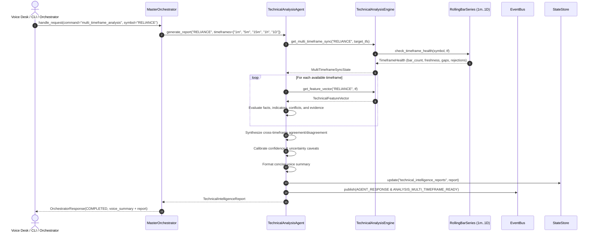

# KAISER — Phase 2, Step 02: Multi-Timeframe Synchronization & Technical Analysis Agent
## Implementation Report

**Document Status:** Complete  
**Date:** 2026-10-03  
**Environment:** Python 3.11.9 (Windows x64)  
**Integration Scope:** Multi-Timeframe Synchronization (`1m`, `5m`, `15m`, `1h`, `1D`), Stream Isolation, Chronological & Gap Detection (`missing_intervals_count`), Stale Bar Gating, Base Agent Architecture (`BaseAgent`), Technical Analysis Specialist Agent (`TechnicalAnalysisAgent`), Evidence-Based Signal Classification (`BULLISH`, `BEARISH`, `NEUTRAL`, `CONFLICTING`, `INSUFFICIENT_DATA`), Structured Intelligence Report (`TechnicalIntelligenceReport`), Master Orchestrator Command (`multi_timeframe_analysis`), EventBus & StateStore Integration, Voice-Friendly Summaries, and Trading Safety Invariants.

---

## 1. Executive Summary

In Phase 2, Step 02, KAISER implemented the **Multi-Timeframe Synchronization & Technical Analysis Specialist Agent**. Expanding directly upon the deterministic indicator foundation built in Step 01, this subsystem introduces rigorous synchronization across 5 canonical market horizons (`1m`, `5m`, `15m`, `1h`, `1D`), enforces strict stream isolation, audits historical continuity without candle fabrication, and launches KAISER's first autonomous specialist agent: `TechnicalAnalysisAgent`.

```
Market Data Feed (Quotes, Bars)
               ↓
MarketDataQualityEngine (Step 04)
     [Quality Assessment: safe_to_consume]
               ↓
    ┌──────────┴──────────┐
    ▼                     ▼
[Unsafe / Quarantined] [Verified Safe Bar]
(Rejected & Logged)       ↓
               TechnicalAnalysisEngine
                          │
               ┌──────────┴──────────┐
               ▼                     ▼
      RollingBarSeries (1m...1D)   Pure Indicators Library
      - Strict Stream Isolation    - SMA, EMA, RSI, MACD, BB, ATR
      - Chronological Order        - Pure Deterministic Math
      - Duplicate & Out-of-Order   - Zero External Runtime Deps
      - Gap / Missing Intervals
               │                     │
               └──────────┬──────────┘
                          ▼
               TechnicalFeatureVector (per timeframe)
                          │
                          ▼
            TechnicalAnalysisAgent (app/agents/technical.py)
            - Multi-Timeframe Health & Synchronization Audit
            - Intra-Timeframe Indicator Evaluation & Disagreement Detection
            - Cross-Timeframe Agreement / Disagreement Synthesis
            - Strict Quality Gating & Uncertainty Communication
            - Clear Separation of Calculated Facts vs Interpretations
                          │
           ┌──────────────┼──────────────┐
           ▼              ▼              ▼
       EventBus       StateStore     MasterOrchestrator
    (AGENT_RESPONSE) (Intelligence)  (multi_timeframe_analysis)
```

### Key Deliverables & Architectural Invariants:
1. **Multi-Timeframe Synchronization Engine (`app/analysis/`):**
   * Supported canonical timeframes: `1m`, `5m`, `15m`, `1h`, and `1D` with canonical normalization (`normalize_timeframe`).
   * Complete symbol and timeframe stream isolation within `RollingBarSeries`.
   * Rejects duplicate timestamps and out-of-order bars, recording explicit telemetry (`duplicate_count`, `out_of_order_count`).
   * Detects missing intervals (gaps) without fabricating candles or silently filling missing data.
   * Audits stream freshness and flags stale timeframes relative to reference clocks and expected timeframe durations.
   * Tracks per-stream quarantined bars rejected by the quality gate (`_stream_rejected_unhealthy`).
2. **Base Specialist Agent Interface (`app/agents/base.py`):**
   * Established `BaseAgent` abstract base class defining lifecycle, thread safety, logger naming, and telemetry contracts for all Phase 2 agents.
3. **Technical Analysis Specialist Agent (`app/agents/technical.py`):**
   * Aggregates SMA (20, 50, 200), EMA (9, 21, 55), Wilder's RSI (14), MACD (12, 26, 9), Bollinger Bands (20, 2.0σ), and Wilder's ATR (14) for every available timeframe.
   * Evaluates directional conditions: `BULLISH`, `BEARISH`, `NEUTRAL`, `CONFLICTING`, `INSUFFICIENT_DATA`.
   * Explicitly explains intra-timeframe and cross-timeframe indicator disagreements instead of forcing a single bias.
   * Restricts confidence whenever higher/lower timeframes are missing, stale, or unhealthy.
   * Strictly disclaims unsupported price predictions, guaranteed returns, or claims of certainty.
4. **Structured Intelligence Report (`TechnicalIntelligenceReport`):**
   * Includes symbol, UTC timestamp, and ISO timestamp.
   * Detailed timeframe coverage map (`AVAILABLE`, `MISSING`, `STALE`, `UNHEALTHY`, `INSUFFICIENT_DATA`).
   * Per-timeframe `TimeframeSignalReport` detailing calculated facts, supporting evidence, indicator conflicts, and warnings.
   * Global cross-timeframe agreement assessment (`AGREEMENT`, `DISAGREEMENT`, `MIXED`, `INSUFFICIENT_DATA`).
   * Explicit separation between pure calculated `facts` and subjective `interpretations`.
   * Standardized `uncertainty_caveats` detailing risk and data limitations.
   * Concise, natural, voice-friendly summary ready for speech synthesis.
5. **Master Orchestrator & Bootstrap Integration (`app/bootstrap.py`):**
   * Registered `multi_timeframe_analysis` command on `MasterOrchestrator`.
   * Instantiated `TechnicalAnalysisAgent` during bootstrap and wired to `SystemStatus.technical_agent`.
   * Published `AGENT_RESPONSE` and `ANALYSIS_MULTI_TIMEFRAME_READY` events on `EventBus`.
   * Cached reports in `StateStore` under `technical_intelligence_reports`.
6. **Trading Safety Invariants:**
   * `execution_locked = True` permanently maintained.
   * Trading engine remains strictly uninitialized.
   * Subsystem is purely analytical with zero direct broker connectivity, trade routing, or execution logic.
7. **Automated Verification:**
   * 30 new deterministic tests in `tests/test_technical_agent.py`.
   * Full test suite of 459 tests passing in 7.65s with 0 failures and 0 regressions.
   * Clean application boot via `python run.py`.

---

## 2. Architecture & Design

### 2.1 Multi-Timeframe Request Lifecycle



### 2.2 Timeframe Health & Quality Matrix

| Timeframe | Duration ($S$) | Freshness Threshold ($T_{stale}$) | Minimum Bars ($N_{min}$) | Supported Indicators |
|:---|:---:|:---:|:---:|:---|
| **1m** | 60s | 150s ($\max(120s, 2.5S)$) | 15 | SMA, EMA, RSI, MACD (35+), BB, ATR |
| **5m** | 300s | 750s ($2.5S$) | 15 | SMA, EMA, RSI, MACD (35+), BB, ATR |
| **15m** | 900s | 2,250s ($2.5S$) | 15 | SMA, EMA, RSI, MACD (35+), BB, ATR |
| **1h** | 3,600s | 9,000s ($2.5S$) | 15 | SMA, EMA, RSI, MACD (35+), BB, ATR |
| **1D** | 86,400s | 216,000s ($2.5S$) | 15 | SMA, EMA, RSI, MACD (35+), BB, ATR |

### 2.3 Signal Categorization & Consensus Matrix

| Condition | Intra-Timeframe Indicator Votes | Cross-Timeframe Alignment | Confidence Level |
|:---|:---|:---|:---:|
| **BULLISH** | $\ge 2$ Bullish votes, 0 Bearish votes (or $\ge 3$ Bullish vs $\le 1$ minor Bearish) | All available healthy timeframes report `BULLISH` | `HIGH` (all 5 healthy)<br>`MEDIUM` (2-4 healthy)<br>`LOW` (partial/degraded) |
| **BEARISH** | $\ge 2$ Bearish votes, 0 Bullish votes (or $\ge 3$ Bearish vs $\le 1$ minor Bullish) | All available healthy timeframes report `BEARISH` | `HIGH` (all 5 healthy)<br>`MEDIUM` (2-4 healthy)<br>`LOW` (partial/degraded) |
| **NEUTRAL** | Oscillating within Bollinger Band middle channel, RSI near 50, MACD histogram near 0 | Mixed or range-bound signals without strong bias | `MEDIUM` or `LOW` |
| **CONFLICTING** | $\ge 2$ Bullish votes AND $\ge 2$ Bearish votes (e.g. Trend MA up vs Momentum RSI/MACD down) | Mixed directional signals across timeframes (e.g. 1m Bullish vs 1h Bearish) | `LOW` |
| **INSUFFICIENT_DATA** | Fewer than 15 historical bars or uncalculated indicators | No healthy timeframes available | `NONE` |

---

## 3. Data Integrity & Invariant Enforcement

1. **No Candle Fabrication:** Missing intervals between bars are detected mathematically ($\Delta t > 1.5S$) and recorded as gaps (`missing_intervals_count`), but no synthetic candles are ever created.
2. **Confidence Downgrade on Partial Coverage:** If any monitored timeframe is missing, stale, or degraded, overall confidence is restricted and explicit caveats are added to the report.
3. **Fact / Interpretation Separation:** Factual indicator outputs (numbers, levels, bar counts) are stored in `report.facts`, while interpretive commentary is isolated in `report.interpretation` and `report.voice_summary`.
4. **Permanent Execution Lock:** `Settings.execution_locked = True` remains inviolate.

---

## 4. Verification & Test Matrix

All 30 deterministic tests in `tests/test_technical_agent.py` passed cleanly:

| Test Class | Test Case | Target Requirement | Status |
|:---|:---|:---|:---:|
| **TestMultiTimeframeSynchronization** | `test_supported_timeframes_constants` | Verification of 1m, 5m, 15m, 1h, 1D definitions and seconds | **PASSED** |
| | `test_normalize_timeframe_valid_mappings` | Canonical normalization of upper/lower case timeframe strings | **PASSED** |
| | `test_normalize_timeframe_invalid_raises_validation_error` | Strict rejection of unsupported intervals (e.g. 2h, 30m, empty) | **PASSED** |
| | `test_ingestion_across_all_five_supported_timeframes` | Concurrent ingestion across all 5 horizons for a symbol | **PASSED** |
| **TestStreamIsolation** | `test_symbol_isolation` | Independent series and feature vectors across different symbols | **PASSED** |
| | `test_timeframe_isolation_for_same_symbol` | Strict separation of 1m, 5m, 1h, 1D series for the same symbol | **PASSED** |
| | `test_series_rejects_foreign_symbol_or_timeframe` | Rejection of foreign symbol or timeframe bars at series boundary | **PASSED** |
| **TestQualityAndSynchronizationAnomalies** | `test_duplicate_bar_rejection_and_counter` | Duplicate timestamps rejected and increment duplicate_count | **PASSED** |
| | `test_out_of_order_bar_rejection_and_counter` | Out-of-order timestamps rejected and increment out_of_order_count | **PASSED** |
| | `test_missing_intervals_gap_detection` | Detects skipped intervals without synthesizing fake candles | **PASSED** |
| | `test_quarantined_unsafe_bars_tracked_per_stream` | Quarantined bars tracked per-stream and flagged in health | **PASSED** |
| | `test_stale_bar_detection` | Elapsed bar age exceeding threshold marks timeframe STALE | **PASSED** |
| **TestTechnicalAnalysisAgentSingleTimeframe** | `test_agent_initialization_and_status` | Specialist agent lifecycle and telemetry status | **PASSED** |
| | `test_insufficient_history_produces_insufficient_data_condition` | Low bar history gracefully sets INSUFFICIENT_DATA and NONE confidence | **PASSED** |
| | `test_bullish_trend_signal_evidence_and_facts` | Mathematical verification of bullish evidence and facts | **PASSED** |
| | `test_bearish_trend_signal_evidence_and_facts` | Mathematical verification of bearish evidence and facts | **PASSED** |
| | `test_intra_timeframe_conflict_detection` | MA uptrend vs momentum drop correctly detected as CONFLICTING | **PASSED** |
| **TestCrossTimeframeSynthesis** | `test_cross_timeframe_bullish_agreement_across_all_five_horizons` | Full 5-timeframe bullish alignment sets AGREEMENT and BULLISH | **PASSED** |
| | `test_cross_timeframe_directional_conflict` | 1m bullish vs 1h bearish triggers DISAGREEMENT and CONFLICTING | **PASSED** |
| **TestPartialAvailabilityAndQualityGating** | `test_partial_timeframe_availability_caps_confidence` | Missing 4 out of 5 timeframes prevents HIGH confidence | **PASSED** |
| | `test_stale_timeframe_prevents_confident_conclusion` | Stale higher timeframe lowers confidence and warns caller | **PASSED** |
| **TestStructuredIntelligenceReport** | `test_facts_vs_interpretations_separation` | Facts vs interpretations strictly partitioned with uncertainty caveats | **PASSED** |
| | `test_voice_summary_format` | Voice summary is natural, concise, and free of markdown syntax | **PASSED** |
| | `test_report_json_serializability` | Report dictionary is completely serializable | **PASSED** |
| **TestOrchestratorAndBootstrapIntegration** | `test_orchestrator_multi_timeframe_analysis_command_success` | Orchestrator command execution and response formatting | **PASSED** |
| | `test_orchestrator_multi_timeframe_analysis_command_missing_symbol` | Orchestrator validation failure when symbol parameter is omitted | **PASSED** |
| | `test_bootstrap_initializes_technical_agent` | Bootstrap lifecycle boots technical_agent in SystemStatus | **PASSED** |
| | `test_event_bus_and_state_store_integration` | AGENT_RESPONSE and ANALYSIS_MULTI_TIMEFRAME_READY events published | **PASSED** |
| **TestTradingSafetyInvariants** | `test_execution_engine_locked_and_trading_engine_uninitialized` | Settings.execution_locked remains True and trading engine uninitialized | **PASSED** |
| | `test_agent_generates_intelligence_without_broker_calls` | Specialist agent runs without broker calls or trade proposals | **PASSED** |

### Test Suite Execution Summary:
* **Technical Specialist Agent Tests:** 30 passed in 0.99s.
* **Full Project Test Suite:** 459 passed in 7.65s with 0 regressions.
* **CLI Bootstrap:** `python run.py` completes cleanly with exit code 0.

---

## 5. Security & Safety Compliance

1. **Deterministic Risk Invariant:** The specialist technical analysis agent only produces analytical features, signal interpretations, and uncertainty caveats. It possesses no pathway to trigger trades or route orders.
2. **Execution Engine Locked:** `Settings.execution_locked` remains permanently `True`.
3. **Trading Engine Uninitialized:** The trading engine remains uninitialized.
4. **Voice Safety:** No microphone listening or audio capture is active; voice summaries are produced purely as text ready for TTS.
5. **JUJU Project Isolation:** The workspace was strictly confined to `c:\Users\user\Desktop\KAISER`. No external directories were accessed.

---

## 6. Summary of Changed Files

| File | Change Type | Description |
|:---|:---:|:---|
| [`app/agents/base.py`](file:///c:/Users/user/Desktop/KAISER/app/agents/base.py) | Added | Foundational `BaseAgent` abstract base class defining lifecycle, thread safety, and status contracts. |
| [`app/agents/technical.py`](file:///c:/Users/user/Desktop/KAISER/app/agents/technical.py) | Added | `TechnicalAnalysisAgent`, `SignalCondition`, `CrossTimeframeAgreement`, `ConfidenceLevel`, `TimeframeSignalReport`, `TechnicalIntelligenceReport`, and orchestrator handler registration. |
| [`app/agents/__init__.py`](file:///c:/Users/user/Desktop/KAISER/app/agents/__init__.py) | Modified | Exported public API for the specialist agents package. |
| [`app/analysis/models.py`](file:///c:/Users/user/Desktop/KAISER/app/analysis/models.py) | Modified | Added `SUPPORTED_TIMEFRAMES`, `TIMEFRAME_SECONDS`, `normalize_timeframe`, `TimeframeHealthStatus`, `TimeframeHealth`, and `MultiTimeframeSyncState`. |
| [`app/analysis/series.py`](file:///c:/Users/user/Desktop/KAISER/app/analysis/series.py) | Modified | Enhanced `RollingBarSeries` with gap detection (`missing_intervals_count`), duplicate tracking, and out-of-order tracking. |
| [`app/analysis/engine.py`](file:///c:/Users/user/Desktop/KAISER/app/analysis/engine.py) | Modified | Added multi-timeframe accessors, health checking, synchronization audits, and per-stream quarantined bar tracking. |
| [`app/analysis/__init__.py`](file:///c:/Users/user/Desktop/KAISER/app/analysis/__init__.py) | Modified | Exported multi-timeframe constants and synchronization models. |
| [`app/core/events/event.py`](file:///c:/Users/user/Desktop/KAISER/app/core/events/event.py) | Modified | Added `ANALYSIS_MULTI_TIMEFRAME_READY` event type to `EventType`. |
| [`app/bootstrap.py`](file:///c:/Users/user/Desktop/KAISER/app/bootstrap.py) | Modified | Integrated `TechnicalAnalysisAgent`, registered `multi_timeframe_analysis` command, and exposed `status.technical_agent`. |
| [`tests/test_technical_agent.py`](file:///c:/Users/user/Desktop/KAISER/tests/test_technical_agent.py) | Added | 30 deterministic tests covering synchronization, isolation, anomalies, signal classification, cross-timeframe agreement, and safety. |
| [`KAISER_PHASE_2_STEP_02_IMPLEMENTATION_REPORT.md`](file:///c:/Users/user/Desktop/KAISER/KAISER_PHASE_2_STEP_02_IMPLEMENTATION_REPORT.md) | Added | Complete documentation and verification report for Phase 2, Step 02. |

---

## 7. Remaining Limitations & Recommended Next Steps

### Limitations:
* Indicator calculations rely on in-memory rolling windows (`max_bar_history`). Cold starts without historical feeds must accumulate bars before reaching high confidence.
* Cross-timeframe alignment assumes standard market sessions; overnight gap analysis between market close and open can be expanded in subsequent steps.

### Recommended Next Step:
**Phase 2 / Step 03: Sentiment & News Intelligence Agent**  
1. Implement `SentimentAnalysisAgent` in `app/agents/sentiment.py` extending `BaseAgent`.
2. Construct deterministic sentiment feature extraction and news confidence scoring without external heavy LLM dependencies.
3. Wire sentiment events and multi-agent synthesis into the Master Orchestrator.
