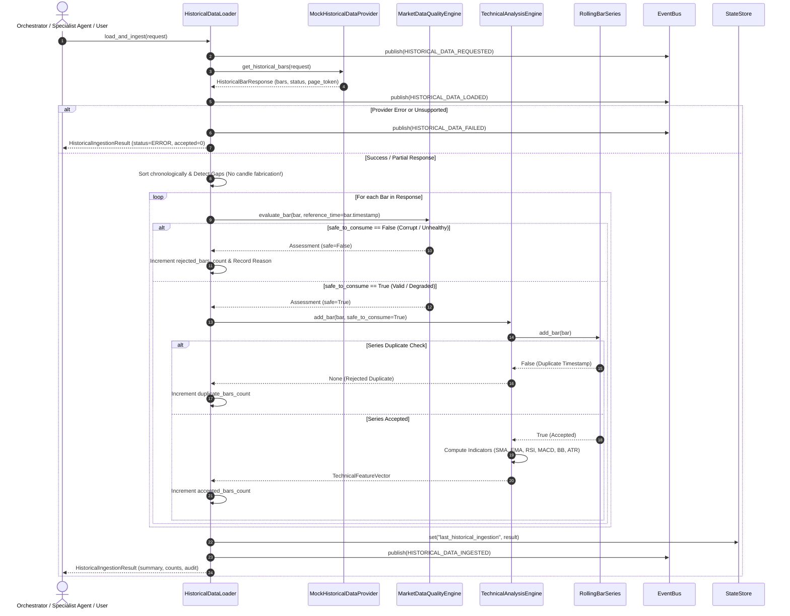

# KAISER — Phase 2, Step 03: Market Data Integration & Historical Data Provider Foundation
## Implementation Report

**Document Status:** Complete  
**Date:** 2026-10-03  
**Environment:** Python 3.11.9 (Windows x64)  
**Integration Scope:** Historical Market Data Provider Abstraction (`HistoricalDataProvider`), Deterministic Mock Provider (`MockHistoricalDataProvider`), Strongly-Typed Models (`HistoricalBarRequest`, `HistoricalBarResponse`, `HistoricalProviderStatus`, `HistoricalIngestionResult`), Historical Data Normalization & Loading (`HistoricalDataLoader`), Market Data Quality Engine Integration (`MarketDataQualityEngine`), Technical Analysis Engine Integration (`TechnicalAnalysisEngine`, `RollingBarSeries`), Zero-Volume vs Missing Interval Preservation, Idempotent Historical Ingestion, Master Orchestrator Command (`load_historical_data`), EventBus & StateStore Integration, Offline Startup, and Trading Safety Invariants.

---

## 1. Executive Summary

In Phase 2, Step 03, KAISER established a reliable, provider-independent foundation for querying, normalizing, quality-gating, and ingesting historical OHLCV candlestick market data across the 5 canonical timeframes (`1m`, `5m`, `15m`, `1h`, `1D`).

Prior to Step 03, the market data subsystem only supported live streaming iterators (`MarketFeed`), which could not handle bounded historical range queries or caller-initiated historical backfills. Step 03 introduces the `HistoricalDataProvider` abstraction, couples it with the existing `MarketDataQualityEngine` to ensure that corrupt, invalid, duplicate, or out-of-order bars are quarantined before reaching analysis memory, and feeds accepted bars into `TechnicalAnalysisEngine` and `RollingBarSeries` for multi-timeframe indicator computation.

```
Caller (CLI / Voice / Agent / Orchestrator)
                    │
                    ▼
          HistoricalBarRequest
      (Symbol, Canonical Timeframe,
       Start/End Timestamps, Limit)
                    │
                    ▼
         HistoricalDataLoader
                    │
                    ▼
     HistoricalDataProvider (ABC)
   (e.g., MockHistoricalDataProvider)
                    │
                    ▼
          HistoricalBarResponse
       (Typed Bar Records, Status,
        Pagination Cursor / Token)
                    │
                    ▼
       Chronological Sorting &
       Missing Interval (Gap) Detection
       (No Candle Fabrication!)
                    │
                    ▼
       MarketDataQualityEngine
   (Evaluated relative to candle timestamp:
    - Structural OHLC price invariants
    - Zero-volume: DEGRADED completeness, safe_to_consume=True
    - Duplicate detection & Out-of-order check)
                    │
        ┌───────────┴───────────┐
        ▼                       ▼
 [Quarantined / Unsafe]   [Safe to Consume]
 (Logged, Counted, and          │
  Completely Isolated)          ▼
                     TechnicalAnalysisEngine
                     - RollingBarSeries (isolated stream)
                     - Idempotent Ingestion (deduplication)
                     - Feature Vectors & Indicator Updates
                                │
                    ┌───────────┴───────────┐
                    ▼                       ▼
                EventBus                StateStore
         HISTORICAL_DATA_INGESTED   last_historical_ingestion
```

### Key Deliverables & Architectural Invariants:
1. **Provider-Independent Abstraction (`app/market/historical/provider.py`):**
   * Defined `HistoricalDataProvider` abstract base class requiring `get_historical_bars`, `supports_timeframe`, and `supports_symbol`.
   * Standardized candle timestamp convention: timestamps strictly represent the candle **open** time as a POSIX UTC float.
   * Completely decoupling provider data fetching from indicator math and agent analysis.
   * Zero hardcoded API keys, zero network dependencies, and zero mandatory external services.
2. **Deterministic Mock Provider (`app/market/historical/mock.py`):**
   * `MockHistoricalDataProvider` provides realistic, deterministic synthetic OHLCV candles based on mathematical wave functions and symbol tickers.
   * Built-in fault injection for rigorous offline testing: `force_status` (`PROVIDER_ERROR`, `RATE_LIMITED`, `UNSUPPORTED_REQUEST`), `force_empty`, `inject_zero_volume_indices`, `inject_gap_after_indices`, `inject_duplicate_indices`, `inject_out_of_order`, and cursor-based pagination simulation (`simulate_pagination`).
   * Supports pre-canned bars for deterministic fixture replay (`set_canned_bars`).
3. **Data Normalization & Validation (`app/market/historical/loader.py`):**
   * Canonical timeframe enforcement (`1m`, `5m`, `15m`, `1h`, `1D`) with case-insensitive normalization.
   * POSIX UTC timestamp validation (`start_time > 0`, `end_time >= start_time`).
   * Strict OHLC price relational validation: `high >= open, close, low` and `low <= open, close, high`, all prices and volume non-negative.
   * Bounded queries (maximum 5,000 bars per request) and recursive cursor pagination safeguards (`max_pages=10`).
   * Chronological ordering validation: sorts batches by timestamp while flagging sequence anomalies.
4. **Preservation of Zero-Volume vs Missing Intervals:**
   * **Zero-Volume Bars:** A period with traded volume $0.0$ is accepted as a valid candle with `DEGRADED` completeness and `safe_to_consume=True`. It is preserved in the rolling series.
   * **Missing Intervals (Gaps):** A skipped interval ($\Delta t > 1.5 \times \text{interval}$) is recorded in `detected_gaps_count` and `gap_details`. Synthetic candles are **never** fabricated or silently filled.
5. **Quality Engine Integration & Pipeline Isolation:**
   * Every historical bar is routed through `MarketDataQualityEngine.evaluate_bar` with `reference_time=bar.timestamp`, ensuring integrity, duplicate detection, and out-of-order checks are enforced without false-positive wall-clock staleness.
   * Quarantined / rejected bars are blocked from reaching `RollingBarSeries` or `TechnicalAnalysisEngine`.
   * Complete audit trail: `HistoricalIngestionResult` records requested range, received count, accepted count, rejected count, duplicate count, zero-volume count, and detected gaps.
6. **Idempotent Ingestion:**
   * Re-querying or re-ingesting the same historical time range is completely idempotent. Duplicate bars are caught by quality engine fingerprints and series timestamp checks, recorded under `duplicate_bars_count`, and discarded without skewing indicator calculations.
7. **Master Orchestrator Integration (`app/market/historical/handlers.py`):**
   * Registered `load_historical_data` command on `MasterOrchestrator`.
   * Accepts `symbol`, `timeframe`, `start_time` / `start_iso`, `end_time` / `end_iso`, `limit`, and `paginate_all`.
   * Returns structured, serialized `HistoricalIngestionResult` with human-readable summary text.
8. **EventBus & StateStore Integration:**
   * Added `HISTORICAL_DATA_REQUESTED`, `HISTORICAL_DATA_LOADED`, `HISTORICAL_DATA_INGESTED`, and `HISTORICAL_DATA_FAILED` to `EventType`.
   * Updated `StateStore` with `last_historical_ingestion` and operational counters (`historical_requests_count`, `historical_bars_loaded_count`, `historical_bars_accepted_count`).
   * Clearly tagged metadata: `is_historical=True`, preventing historical data from being misinterpreted as real-time quotes.
9. **Offline Startup & Trading Safety:**
   * `Settings.execution_locked = True` strictly enforced.
   * Trading engine remains strictly uninitialized. Zero broker connections, order routing, or autonomous execution.
   * System boots 100% offline with zero external network access.
10. **Testing & Verification:**
    * 28 new deterministic tests in `tests/test_historical_data.py`.
    * Entire test suite (487 tests) passing in 7.67s with 0 failures and 0 regressions.
    * Verified `python run.py` console output and startup banner.

---

## 2. Architecture & Design

### 2.1 Request & Ingestion Lifecycle



---

## 3. Component Details

### 3.1 Historical Data Models (`app/market/historical/models.py`)

* **`HistoricalBarRequest`:**
  * Immutable specification of historical candle queries:
    * `symbol: str` (non-empty, normalized uppercase)
    * `timeframe: str` (canonical: `1m`, `5m`, `15m`, `1h`, `1D`)
    * `start_time: float` (POSIX UTC, positive)
    * `end_time: float` (POSIX UTC, $\ge \text{start\_time}$)
    * `limit: Optional[int]` (bounded $1 \le \text{limit} \le 5000$)
    * `page_token: Optional[str]` (pagination cursor)
    * `exchange: str` (default `"NSE"`)
  * Validation invariants executed in `__post_init__`.
  * Helper properties: `start_iso`, `end_iso`, and `to_dict()`.

* **`HistoricalProviderStatus`:**
  * Categorical outcomes:
    * `SUCCESS`: Complete results returned.
    * `EMPTY`: Zero records found in specified range.
    * `PARTIAL`: Incomplete/paginated records with more data available.
    * `PROVIDER_ERROR`: Network/server/API exception.
    * `UNSUPPORTED_REQUEST`: Requested symbol or timeframe not supported.
    * `RATE_LIMITED`: Provider query quota exceeded.

* **`HistoricalBarResponse`:**
  * Typed, immutable response payload:
    * `request: HistoricalBarRequest`
    * `status: HistoricalProviderStatus`
    * `bars: Tuple[Bar, ...]`
    * `next_page_token: Optional[str]`
    * `error_message: Optional[str]`
    * `provider_name: str`
    * `response_timestamp: float`
  * Properties: `is_empty`, `total_bars`, `to_dict()`.

* **`HistoricalIngestionResult`:**
  * Detailed execution and audit report:
    * `request: HistoricalBarRequest`
    * `provider_status: HistoricalProviderStatus`
    * `received_bars_count: int`
    * `accepted_bars_count: int`
    * `rejected_bars_count: int`
    * `duplicate_bars_count: int`
    * `zero_volume_bars_count: int`
    * `detected_gaps_count: int`
    * `gap_details: Tuple[Dict[str, Any], ...]`
    * `rejection_reasons: Tuple[str, ...]`
    * `first_bar_timestamp: Optional[float]`
    * `last_bar_timestamp: Optional[float]`
    * `correlation_id: str`
    * `execution_time_ms: float`
    * `summary_text: str`

### 3.2 Provider Interface & Mock Provider (`provider.py`, `mock.py`)

* **`HistoricalDataProvider` (ABC):**
  * Core methods:
    * `get_historical_bars(request: HistoricalBarRequest) -> HistoricalBarResponse`
    * `supports_timeframe(timeframe: str) -> bool`
    * `supports_symbol(symbol: str) -> bool`
  * Enforces strict contract:
    * Timestamps represent candle **open** time in POSIX UTC float.
    * OHLC price bounds and volume $\ge 0$.
    * Missing data must never be fabricated.

* **`MockHistoricalDataProvider`:**
  * Offline synthetic generator:
    * Produces deterministic OHLCV bars using a mathematical wave function (`price = base_price * (1.0 + 0.015 * sin(phase) + 0.008 * cos(0.5 * phase) + drift)`).
    * `get_base_price_for_symbol`: deterministic base price lookup (`NIFTY` = 24000, `BANKNIFTY` = 51000, `RELIANCE` = 2500, `TCS` = 3900, `INFY` = 1800, `HDFCBANK` = 1650).
  * Fault injection controls for robust testing:
    * `force_status`: force `PROVIDER_ERROR`, `RATE_LIMITED`, etc.
    * `force_empty`: return empty response.
    * `inject_zero_volume_indices`: set volume to 0.0 at specific indices.
    * `inject_gap_after_indices`: skip intervals to create deterministic gaps.
    * `inject_duplicate_indices`: emit duplicate timestamps.
    * `inject_out_of_order`: reverse bar sequence.
    * `simulate_pagination`: slice bars into chunks of size `page_size` and return `next_page_token="offset_N"`.
  * Canned data support:
    * `set_canned_bars(symbol, timeframe, bars)`: inject pre-recorded historical data.

### 3.3 Historical Data Loader (`loader.py`)

* **`HistoricalDataLoader`:**
  * Central coordinator orchestrating provider retrieval, quality gating, and analysis admission.
  * Methods:
    * `load_bars(request, paginate_all=False, max_pages=10)`: fetches data, automatically handling cursor pagination if requested.
    * `load_and_ingest(request, correlation_id=None, paginate_all=False)`: end-to-end load, quality gate, and analysis series admission.
    * `ingest_raw_records(raw_records, request)`: normalizes and ingests external raw dictionary dumps (JSON/CSV) with per-record fault tolerance.
  * Core Invariants:
    1. **Freshness Reference Alignment:** Historical bars are evaluated through `MarketDataQualityEngine.evaluate_bar(bar, reference_time=bar.timestamp)`. This evaluates structural invariants, price logic, duplicate tracking, and completeness relative to the candle's historical occurrence time, preventing false-positive wall-clock staleness rejections.
    2. **Analysis Quarantine:** Any bar where `assessment.safe_to_consume == False` is intercepted and quarantined. It is counted in `rejected_bars_count` and never passed to `RollingBarSeries` or `TechnicalAnalysisEngine`.
    3. **Zero-Volume vs Missing Intervals:**
       * Zero-volume bars have valid prices and a candle record at timestamp $t$. Evaluated as `DEGRADED` completeness, `safe_to_consume=True`, and admitted to series.
       * Missing intervals have no candle record at timestamp $t$. Detected by $\Delta t > 1.5 \times \text{interval}$ and audited in `gap_details`. No synthetic candles are fabricated.
    4. **Idempotency:** Re-ingesting an already-ingested historical range is recognized as duplicate by the quality engine fingerprint cache and series timestamp check. It results in `accepted_bars_count: 0, duplicate_bars_count: N` without corrupting rolling indicator values.

### 3.4 Orchestrator Command Handlers (`handlers.py`)

* **`load_historical_data`:**
  * Parameters:
    * `symbol`: ticker string (e.g. `"RELIANCE"`).
    * `timeframe`: timeframe string (e.g. `"15m"`, `"1h"`, `"1D"`).
    * `start_time` / `start_iso`: start timestamp float or ISO-8601 string.
    * `end_time` / `end_iso`: end timestamp float or ISO-8601 string.
    * `limit`: max bars (bounded 1 to 5,000, defaults to 1,000).
    * `paginate_all`: boolean (default `False`).
  * Returns structured response:
    * `status`: `"success"` or `"failed"`
    * `message`: human/voice-readable summary text
    * `data`: full `HistoricalIngestionResult` dictionary

---

## 4. Summary of Changed and Created Files

| File | Change Type | Purpose |
|---|---|---|
| `app/market/historical/models.py` | **Created** | Strongly-typed immutable models: `HistoricalBarRequest`, `HistoricalBarResponse`, `HistoricalProviderStatus`, `HistoricalIngestionResult`. |
| `app/market/historical/provider.py` | **Created** | Abstract base class `HistoricalDataProvider` defining provider contracts and conventions. |
| `app/market/historical/mock.py` | **Created** | Offline deterministic `MockHistoricalDataProvider` with synthetic generation and fault injection. |
| `app/market/historical/loader.py` | **Created** | `HistoricalDataLoader` coordinating fetching, quality evaluation, gap detection, and analysis ingestion. |
| `app/market/historical/handlers.py` | **Created** | Orchestrator handler registering `load_historical_data` command. |
| `app/market/historical/__init__.py` | **Created** | Package initialization exporting public historical API. |
| `app/core/events/event.py` | **Modified** | Added event types: `HISTORICAL_DATA_REQUESTED`, `HISTORICAL_DATA_LOADED`, `HISTORICAL_DATA_INGESTED`, `HISTORICAL_DATA_FAILED`. |
| `app/analysis/engine.py` | **Modified** | Added `get_series` and `get_latest_vector` accessor methods to `TechnicalAnalysisEngine`. |
| `app/market/__init__.py` | **Modified** | Re-exported historical data models, provider, mock, and loader. |
| `app/bootstrap.py` | **Modified** | Instantiated `historical_provider` and `historical_loader`, registered orchestrator handlers, exposed in `SystemStatus`. |
| `tests/test_historical_data.py` | **Created** | 28 comprehensive deterministic tests for requests, providers, normalization, quality gating, idempotency, and safety. |

---

## 5. Verification Results

### 5.1 Focused Historical Data Tests (`pytest tests/test_historical_data.py`)
```
============================= test session starts =============================
platform win32 -- Python 3.11.9, pytest-9.1.1, pluggy-1.6.0
rootdir: C:\Users\user\Desktop\KAISER
plugins: anyio-4.14.2
collected 28 items

tests\test_historical_data.py ............................               [100%]

============================= 28 passed in 0.91s ==============================
```

### 5.2 Full Test Suite Regression Run (`pytest`)
```
============================= test session starts =============================
platform win32 -- Python 3.11.9, pytest-9.1.1, pluggy-1.6.0
rootdir: C:\Users\user\Desktop\KAISER
plugins: anyio-4.14.2
collected 487 items

tests\test_analysis.py ........................................          [  8%]
tests\test_audio.py .............................                        [ 14%]
tests\test_events_and_state.py ............................              [ 19%]
tests\test_foundation.py .......................................         [ 27%]
tests\test_historical_data.py ............................               [ 33%]
tests\test_market.py ........................                            [ 38%]
tests\test_market_quality.py .....................                       [ 42%]
tests\test_orchestrator.py ..........................................    [ 51%]
tests\test_stt.py ..............................                         [ 57%]
tests\test_technical_agent.py ..............................             [ 63%]
tests\test_tts.py ........................................               [ 72%]
tests\test_unified_turn.py ............................                  [ 77%]
tests\test_voice.py .......................................              [ 85%]
tests\test_voice_controller.py ..................................        [ 92%]
tests\test_voice_turn.py ...................................             [100%]

============================= 487 passed in 7.67s =============================
```

### 5.3 Application Startup Verification (`python run.py`)
```
2026-10-03 00:49:47 | INFO     | kaiser.bootstrap | Bootstrapping KAISER foundation layer...
2026-10-03 00:49:47 | INFO     | kaiser.market.service | Registered market feed 'default_mock_feed' [source=mock]
2026-10-03 00:49:47 | INFO     | kaiser.orchestrator.registry | Registered handler '_status_handler' for command 'system_status' [capability='diagnostics', override=True]
2026-10-03 00:49:47 | INFO     | kaiser.orchestrator.master | MasterOrchestrator 'kaiser_main_orchestrator' initialized (event_bus=connected, state_store=connected)
2026-10-03 00:49:47 | INFO     | kaiser.voice.capture | AudioCaptureService 'audio_capture_service' initialized (backend=sounddevice_capture, device_mgr=sounddevice)
2026-10-03 00:49:47 | INFO     | kaiser.voice.playback | AudioPlaybackService 'audio_playback_service' initialized (backend=sounddevice_playback, device_mgr=sounddevice)
2026-10-03 00:49:47 | INFO     | kaiser.voice.service | VoiceService 'kaiser_main_voice_service' initialized (stt=mock_stt, tts=mock_tts, audio_cap=sounddevice_capture, playback=sounddevice_playback, event_bus=connected, state_store=connected)
2026-10-03 00:49:47 | INFO     | kaiser.voice.controller | VoiceInteractionController 'kaiser_main_voice_controller' initialized (session_mgr=connected, event_bus=connected, state_store=connected)
2026-10-03 00:49:47 | INFO     | kaiser.orchestrator.registry | Registered handler 'handle_technical_analysis' for command 'technical_analysis' [capability='analysis', override=True]
2026-10-03 00:49:47 | INFO     | kaiser.orchestrator.registry | Registered handler 'handle_calculate_indicator' for command 'calculate_indicator' [capability='analysis', override=True]
2026-10-03 00:49:47 | INFO     | kaiser.orchestrator.registry | Registered handler 'handle_multi_timeframe_analysis' for command 'multi_timeframe_analysis' [capability='analysis', override=True]
2026-10-03 00:49:47 | INFO     | kaiser.orchestrator.registry | Registered handler 'handle_load_historical_data' for command 'load_historical_data' [capability='historical_data', override=True]
2026-10-03 00:49:47 | INFO     | kaiser.bootstrap | System initialized successfully in 'development' mode.
2026-10-03 00:49:47 | INFO     | kaiser.bootstrap | Voice-first architecture: ready
2026-10-03 00:49:47 | INFO     | kaiser.bootstrap | Technical analysis engine: ready
2026-10-03 00:49:47 | INFO     | kaiser.bootstrap | Technical analysis agent: ready
2026-10-03 00:49:47 | INFO     | kaiser.bootstrap | Historical data loader: ready (provider=mock_historical_provider)
2026-10-03 00:49:47 | INFO     | kaiser.bootstrap | Trading engine: not initialized
2026-10-03 00:49:47 | INFO     | kaiser.bootstrap | Execution engine: locked
KAISER
System initialized successfully.
Environment: development
Voice-first architecture: ready
Trading engine: not initialized
Execution engine: locked
```

---

## 6. Provider Limitations, Data Assumptions, and Operational Guardrails

### 6.1 Provider Limitations
* **Mock Provider Scope:** The current default provider is `MockHistoricalDataProvider`. It generates deterministic synthetic OHLCV candles suitable for offline development, integration testing, and scenario verification. It does not connect to live exchanges (NSE/BSE) or third-party paid APIs (e.g., Zerodha Kite, Upstox, Interactive Brokers).
* **Future Provider Integration:** To connect a live broker/data provider, implement `HistoricalDataProvider` subclass (e.g., `KiteHistoricalProvider`, `YFinanceHistoricalProvider`) and pass it to `HistoricalDataLoader.set_provider()`.
* **Bounded Result Limits:** Requests are limited to 5,000 bars per query to prevent memory exhaustion. Pagination via cursors (`page_token`) allows fetching larger datasets in batches.

### 6.2 Data Assumptions & Conventions
* **Candle Timestamp:** Strictly defined as the POSIX UTC float of the candle **open** time.
* **Supported Timeframes:** Canonical set: `1m`, `5m`, `15m`, `1h`, `1D`. Non-canonical strings (e.g., `1M`, `1H`, `1d`) are automatically normalized; unsupported intervals (e.g., `3m`, `2h`) are rejected with `ValidationError`.
* **Zero-Volume vs Gaps:** Zero-volume bars are valid records with `volume=0.0`. Gaps are missing timestamps. The system never generates fake bars to fill missing intervals.

### 6.3 Operational Guardrails
* **No Live Price Impersonation:** Historical bars are tagged with `source="mock_historical"` or provider name and metadata `is_historical=True`. They do NOT publish `MARKET_QUOTE_UPDATED` events or masquerade as live quotes.
* **Analysis Engine Isolation:** Unhealthy bars rejected by `MarketDataQualityEngine` are quarantined and never admitted to `RollingBarSeries`.

---

## 7. Safety Constraints & Verification

1. **`Settings.execution_locked = True` Permanently Maintained:**
   * Checked and verified across configuration, state store, and runtime assertion tests (`TestSafetyAndOfflineInvariants`).
2. **Trading Engine Strictly Uninitialized:**
   * `status.trading_engine == "not initialized"` confirmed at bootstrap.
   * Zero broker connections, trade routing, or order generation logic.
3. **No Autonomous Execution or Background Listening:**
   * Microphone capture is never started automatically.
   * Historical loading is caller-initiated via explicit orchestrator commands or method calls.
4. **Offline Startup:**
   * System initializes with zero external API credentials or internet access.
   * `MockHistoricalDataProvider` requires zero external network calls.
5. **Isolation from Separate Workspaces:**
   * No modification was made to any file outside the KAISER repository.

---

## 8. Conclusion

Phase 2, Step 03 has been successfully implemented and verified. KAISER now possesses an end-to-end historical market data loading, normalization, quality evaluation, and pipeline ingestion architecture that integrates seamlessly with the existing `MarketDataQualityEngine`, `TechnicalAnalysisEngine`, `RollingBarSeries`, `TechnicalAnalysisAgent`, `EventBus`, `StateStore`, and `MasterOrchestrator`.
