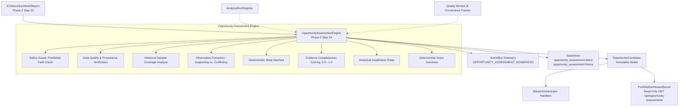

# KAISER Phase 2, Step 24 Implementation Report: Evidence-Grounded Decision Support & Opportunity Analysis Foundation

> **CRITICAL ARCHITECTURAL MANDATE & NON-PRESCRIPTIVE BOUNDARY:**  
> **This system provides evidence-grounded analytical assessment only. It does not provide trading recommendations, execution instructions, or profitability guarantees.**  
> `Settings.execution_locked` remains permanently `True`. Live trading, broker integration, real-money execution, autonomous order execution, trading recommendations (`BUY`, `SELL`, `HOLD`), entry/exit prices, position sizing, leverage, and stop-loss/take-profit parameters are strictly prohibited. External repository `JUJU/` is completely untouched.

---

## 1. Objective

The objective of Phase 2, Step 24 is to establish the production foundation for an **Evidence-Grounded Decision Support and Opportunity Analysis** layer within KAISER.

Rather than deciding what trades a user should execute or predicting price direction, this layer transforms an existing `EvidenceSynthesisReport` (produced in Phase 2, Step 23) into a structured, traceable, uncertainty-aware, quality-aware, provenance-aware, and reproducible analytical assessment of whether an analyzed market situation has sufficient empirical backing to warrant further human investigation.

Key requirements fulfilled:
- **Evidence-Grounded**: Every assessment is synthesized strictly from verifiable analytical observations and metrics.
- **Deterministic**: Given identical evidence reports and inputs, the engine outputs an identical opportunity candidate and voice summary.
- **Traceable**: Fully links every candidate to source report IDs, run IDs, provenance records, quality assessments, and reproducibility hashes.
- **Uncertainty- & Quality-Aware**: Data quality status, provenance completeness, sample coverage, and epistemic uncertainties directly govern the candidate state.
- **Explicit Invalidation**: Formulates deterministic condition rules under which an analytical candidate becomes invalidated.
- **Strictly Non-Prescriptive**: Prohibits any trading recommendations, side indications, price targets, orders, sizing, leverage, or broker calls.

---

## 2. Architecture & System Flow



---

## 3. Files Created and Modified

### New Files Created
1. `app/analysis/opportunities/__init__.py`: Package entrypoint exporting domain models, enumerations, engine, handlers, and safety validators.
2. `app/analysis/opportunities/models.py`: Immutable domain models (`OpportunityCandidate`, `ObservationWindow`, `OpportunityVoiceSummary`), enums (`OpportunityState`, `ConfidenceState`), safety guards (`PROHIBITED_RECOMMENDATION_FIELDS`, `validate_no_prohibited_fields`), and parsing helpers.
3. `app/analysis/opportunities/engine.py`: `OpportunityAssessmentEngine` implementing deterministic verification, conflict detection, completeness scoring, candidate generation, invalidation handling, EventBus publication, and StateStore persistence.
4. `app/analysis/opportunities/handlers.py`: Orchestrator handlers (`handle_generate_opportunity_assessment`, `handle_get_opportunity_assessment`, `handle_list_opportunity_assessments`, `handle_validate_opportunity_assessment`) with prohibited field validation.
5. `tests/test_phase_2_step_24_opportunity_assessment.py`: Comprehensive test suite containing 31 focused tests covering states, invalidations, numerical safety, prohibited field rejections, EventBus, StateStore, dashboard endpoints, and safety invariants.

### Existing Files Modified
1. `app/analysis/__init__.py`: Re-exported opportunity models, engine, and orchestrator handler registration.
2. `app/core/events/event.py`: Added event types:
   - `EventType.OPPORTUNITY_ASSESSMENT_GENERATED`
   - `EventType.OPPORTUNITY_ASSESSMENT_FAILED`
   - `EventType.OPPORTUNITY_ASSESSMENT_INVALIDATED`
3. `app/portfolio/dashboard/server.py`:
   - Added read-only endpoints: `GET /api/opportunity-assessments` and `GET /api/opportunity-assessments/<candidate_id>`.
   - Added `do_HEAD` support returning HTTP headers with zero response body.
   - Wired `opportunity_engine` into constructor and handler routing.
4. `app/bootstrap.py`:
   - Instantiated `OpportunityAssessmentEngine`.
   - Registered opportunity handlers with `MasterOrchestrator`.
   - Wired `opportunity_engine` into `PortfolioDashboardServer` and `SystemStatus`.
   - Added bootstrap logging and status diagnostics.

---

## 4. Domain Models & Immutability

All domain models are implemented as frozen dataclasses (`frozen=True`) with tuples for nested collections:

### `OpportunityState` (Enum)
- `INSUFFICIENT_EVIDENCE`: Supporting evidence is lacking or sample coverage is too sparse.
- `DATA_QUALITY_LIMITED`: Data quality is degraded or unverified.
- `EVIDENCE_CONFLICTING`: Conflicting evidence is detected across observations or metrics.
- `EVIDENCE_PARTIAL`: Evidence is partially supportive, but some required components or out-of-sample data are missing.
- `ANALYTICALLY_SUPPORTED`: Complete supporting evidence with verified data quality, provenance, and zero conflicts.
- `REQUIRES_REVIEW`: Uncertainties or limitations exist requiring expert human review.
- `INVALIDATED`: Invalidation conditions triggered or candidate explicitly revoked.

### `ConfidenceState` (Enum)
- `HIGH`: Fully verified provenance, clean data quality, and strong sample coverage.
- `MODERATE`: Provenance or coverage partially established.
- `LOW`: Epistemic uncertainties or degraded quality observed.
- `UNVERIFIED`: Provenance or quality metrics unavailable.

### `ObservationWindow`
Immutable specification of the analytical timeframe window:
- `start_time`: float UTC epoch
- `end_time`: float UTC epoch
- `bar_count`: int
- `coverage_ratio`: float

### `OpportunityCandidate`
The core immutable assessment structure:
- `candidate_id`: String formatted as `opp_<uuid4_hex>`
- `symbol`: e.g. `"EURUSD"`
- `timeframe`: e.g. `"1h"`
- `observation_window`: `ObservationWindow`
- `evidence_status`: `EvidenceStatus` from Step 23
- `evidence_strength`: `evidence_completeness_score` (0.0 to 1.0)
- `assessment_state`: `OpportunityState`
- `confidence_state`: `ConfidenceState`
- `data_quality_status`: `DataQualityStatus`
- `provenance_status`: `EvidenceStatus`
- `reproducibility_status`: `EvidenceStatus`
- `sample_coverage`: `SampleCoverage`
- `supporting_evidence_refs`: Tuple[str, ...]
- `conflicting_evidence_refs`: Tuple[str, ...]
- `uncertainty_refs`: Tuple[str, ...]
- `limitation_refs`: Tuple[str, ...]
- `key_observations`: Tuple[KeyObservation, ...]
- `invalidation_conditions`: Tuple[str, ...]
- `generated_at`: float UTC epoch
- `source_evidence_report_id`: str
- `source_analysis_run_ids`: Tuple[str, ...]
- `reproducibility_id`: str
- `voice_summary`: `OpportunityVoiceSummary`
- `metadata`: Tuple[Tuple[str, str], ...]

---

## 5. State Machine & Deterministic Assessment Logic

The assessment engine follows a deterministic decision tree without stochastic elements, probabilistic forecasting, or trading assumptions:

```
[Input EvidenceSynthesisReport]
        │
        ▼
Is evidence report stale / unavailable / empty?
  ├── YES ──► State = INSUFFICIENT_EVIDENCE
  └── NO
        │
        ▼
Is data quality INVALID or DEGRADED?
  ├── YES ──► State = DATA_QUALITY_LIMITED
  └── NO
        │
        ▼
Are there any unresolved conflicts (conflicts > 0)?
  ├── YES ──► State = EVIDENCE_CONFLICTING
  └── NO
        │
        ▼
Is sample coverage < 30 bars or out-of-sample missing?
  ├── YES ──► State = EVIDENCE_PARTIAL
  └── NO
        │
        ▼
Do uncertainties or limitations exist (> 0)?
  ├── YES ──► State = REQUIRES_REVIEW
  └── NO
        │
        ▼
State = ANALYTICALLY_SUPPORTED
```

---

## 6. Deterministic Completeness Score

To avoid false illusions of predictive accuracy, KAISER prohibits "win rate predictions", "trade probabilities", or "confidence percentages".

Instead, `evidence_strength` is computed as an **Evidence Completeness Score** bounded between `0.0` and `1.0`:
- **Base Components**:
  - `0.25`: Valid, verified data quality (`VALID`)
  - `0.25`: Verified data provenance (`AVAILABLE`)
  - `0.20`: Documented run reproducibility (`AVAILABLE`)
  - `0.20`: Adequate historical sample coverage (`coverage_ratio >= 0.8` and `bar_count >= 30`)
  - `0.10`: Presence of structured key observations (`key_observations >= 1`)
- **Penalties**:
  - `-0.30`: Presence of unresolved conflicts
  - `-0.15`: Epistemic uncertainties present
  - `-0.10`: Limitations noted
- Clamped strictly to `[0.0, 1.0]`.

---

## 7. Analytical Invalidation Rules

Every candidate generates explicit analytical conditions that would invalidate its investigative value:
1. `Data quality degrades to INVALID or DEGRADED`
2. `Market data provenance becomes unavailable or untracked`
3. `Analysis run reproducibility metadata is revoked or corrupted`
4. `Source evidence synthesis report becomes stale (> 24 hours)`
5. `Unresolved conflicting evidence appears across timeframes or metrics`
6. `Historical sample coverage drops below minimal analytical threshold (< 30 bars)`
7. `Source analysis run status changes to FAILED or INVALIDATED`

These are analytical invalidation triggers only, **never** trade exit rules.

---

## 8. Safety Guards & Prohibited Fields

### Prohibited Recommendation Fields
An explicit rejection guard checks incoming payloads against forbidden trading parameters:
- `action`, `side`, `order`, `entry`, `exit`, `quantity`, `position_size`, `leverage`, `stop_loss`, `take_profit`, `broker_order`, `execution_instruction`, `target_price`, `limit_price`
Any attempt to pass these fields raises a `ValueError` with clear audit logging.

### Voice Summary Safety
The speech-ready summary is constructed deterministically and verified via `FORBIDDEN_VOICE_WORDS`:
- Prohibits: `BUY`, `SELL`, `HOLD`, `ENTER`, `EXIT`, `LONG`, `SHORT`, `POSITION SIZE`, `LEVERAGE`, `ORDER`, `EXECUTE`.
- Generates compliant voice statements such as:
  > *"KAISER analytical assessment: evidence is partially supportive, but data quality limitations remain. Historical validation is available, while out-of-sample coverage is limited. Further human review is required."*

---

## 9. Handlers, EventBus & StateStore Integration

### Master Orchestrator Handlers
Registered under capability `opportunity_assessment`:
- `handle_generate_opportunity_assessment`: Synthesizes candidate from `evidence_report_id` or provided report. Rejects payloads with prohibited fields.
- `handle_get_opportunity_assessment`: Retrieves candidate by `candidate_id`.
- `handle_list_opportunity_assessments`: Returns bounded list of candidates with limit/offset.
- `handle_validate_opportunity_assessment`: Validates an existing candidate against live data quality or explicit invalidation triggers.

### EventBus Events
- `EventType.OPPORTUNITY_ASSESSMENT_GENERATED`: Published on successful candidate creation with sanitized metadata (`candidate_id`, `state`, `symbol`, `source_evidence_report_id`).
- `EventType.OPPORTUNITY_ASSESSMENT_FAILED`: Published on generation failure.
- `EventType.OPPORTUNITY_ASSESSMENT_INVALIDATED`: Published when a candidate is invalidated.
All events contain zero secrets, zero audio, zero transcripts, and zero absolute filepaths.

### StateStore Persistence
- `opportunity_assessment:latest`: Stores the most recently generated candidate.
- `opportunity_assessment:history`: Bounded FIFO list of historical candidates (bounded to `max_history`, default 100).

---

## 10. Dashboard Read-Only Endpoints

Added to `PortfolioDashboardServer` (loopback only: `127.0.0.1`):
- `GET /api/opportunity-assessments`: Lists all generated assessments with metadata, count, limit, offset, and execution locked confirmation.
- `GET /api/opportunity-assessments/<candidate_id>`: Returns full assessment payload including supporting/conflicting evidence, invalidation conditions, and reproducibility IDs.
- `HEAD`: Supported on all endpoints, returning HTTP headers with zero body.
- Mutating methods (`POST`, `PUT`, `DELETE`): Return HTTP `405 Method Not Allowed`.
- Path traversal protection: Path segments containing `..` or illegal characters return HTTP `400 Bad Request`.

---

## 11. Test Execution & Verification

### Focused Step 24 Test Suite
File: `tests/test_phase_2_step_24_opportunity_assessment.py`
Command: `python -m pytest tests/test_phase_2_step_24_opportunity_assessment.py -v`
**Result: 31 passed in 1.61s**

Test coverage includes:
1. `test_valid_evidence_assessment_analytically_supported`: Complete valid report yields `ANALYTICALLY_SUPPORTED`.
2. `test_insufficient_evidence_when_report_stale_or_unavailable`: Stale report yields `INSUFFICIENT_EVIDENCE`.
3. `test_insufficient_evidence_when_observations_empty`: Empty observations yield `INSUFFICIENT_EVIDENCE`.
4. `test_conflicting_evidence_detection`: Conflicting observations yield `EVIDENCE_CONFLICTING`.
5. `test_stale_evidence_handling`: Stale observations flagged in invalidation and state.
6. `test_invalid_data_quality_limited_state`: Degraded/invalid data quality yields `DATA_QUALITY_LIMITED`.
7. `test_missing_provenance_detection`: Unavailable provenance yields `ConfidenceState.UNVERIFIED`.
8. `test_missing_reproducibility_detection`: Missing reproducibility hash tracked in uncertainties.
9. `test_partial_historical_coverage`: Small bar count yields `EVIDENCE_PARTIAL`.
10. `test_supporting_evidence_traceability`: Traceable links to source runs and evidence items.
11. `test_conflicting_evidence_traceability`: Conflicting items segregated and traceable.
12. `test_invalidation_conditions_preservation`: Invalidation rules populated.
13. `test_deterministic_output_and_identical_runs`: Repeated runs produce identical candidates.
14. `test_nan_rejection_in_candidate_metrics`: NaN values rejected with ValueError.
15. `test_infinity_rejection_in_candidate_metrics`: Infinity values rejected with ValueError.
16. `test_zero_preservation_in_candidate_metrics`: Genuine 0.0 values preserved.
17. `test_prohibited_recommendation_fields_rejection`: Payload fields like `order`, `entry` rejected.
18. `test_voice_summary_contains_no_forbidden_words`: Voice summary verified clean of forbidden words.
19. `test_eventbus_lifecycle_events`: Telemetry events verified on EventBus.
20. `test_statestore_bounded_history`: StateStore retention verified against max history limit.
21. `test_candidate_invalidation_workflow`: Invalidation event and StateStore update tested.
22. `test_orchestrator_handlers`: MasterOrchestrator handler execution verified.
23. `test_orchestrator_prohibited_fields_rejection`: Orchestrator rejects payloads with forbidden fields.
24. `test_dashboard_get_endpoints`: Dashboard GET endpoints return 200 with JSON payload.
25. `test_dashboard_head_endpoints`: Dashboard HEAD endpoints return 200 with zero body.
26. `test_dashboard_mutating_methods_return_405`: Dashboard POST returns 405.
27. `test_dashboard_path_traversal_rejection`: Path traversal `../` returns 400.
28. `test_execution_lock_remains_enabled`: Execution lock verified `True`.
29. `test_no_broker_initialization`: Broker instances verified absent.
30. `test_no_autonomous_execution`: Autonomous execution paths absent.
31. `test_juju_isolation`: `JUJU/` verified unreferenced and isolated.

### Full Regression Test Suite
Command: `python -m pytest -q`
**Result: 1,025 passed in 62.85s (0 failures, 0 errors)**

### Startup Verification
Command: `python run.py`
**Result: Exit Code 0**
```
======================================================================
  KAISER — AI TRADING DESK FOUNDATION
======================================================================
  Version:            0.1.0
  Environment:        development
  Voice Interface:    ready
  Market Monitor:     ready
  Provenance Tracker: ready
  Analysis Registry:  ready (1000 max runs)
  Comparison Engine:  ready (500 comparisons cached)
  Evidence Engine:    ready (100 reports cached)
  Opportunity Engine: ready (100 candidates cached)
  Technical Engine:   ready
  Historical Loader:  ready (mock_historical_provider)
  Replay Engine:      ready
  Backtest Engine:    ready (sma_crossover)
  Walk-Forward:       ready
  Robustness:         ready
  Risk Monitor:       ready
  Reporting Service:  ready
  Dashboard UI:       ready (offline)
  Trading Engine:     NOT INITIALIZED
  Execution Status:   LOCKED
======================================================================
```

### Dashboard Startup & Query Verification
Command: `bootstrap_system(settings=Settings(dashboard_enabled=True, dashboard_port=8089))`
**Result: HTTP 200**
- Successfully bound to `http://127.0.0.1:8089`
- `GET /api/opportunity-assessments` returned status 200 with keys: `['status', 'read_only', 'execution_locked', 'count', 'limit', 'offset', 'assessments']`
- Server stopped cleanly without resource leaks.

---

## 12. Safety Verification Summary

| Invariant | Status | Verification Detail |
|---|---|---|
| `Settings.execution_locked` | LOCKED (`True`) | Verified in config, bootstrap, and tests |
| Trading engine | NOT INITIALIZED | Confirmed `None` at all bootstrap stages |
| Broker integration | ABSENT | No broker modules imported or instantiated |
| Autonomous execution | PROHIBITED | No autonomous order routing code |
| Prohibited recommendation fields | STRICTLY REJECTED | `validate_no_prohibited_fields` raises `ValueError` |
| Voice summary safety | ENFORCED | Verified against `FORBIDDEN_VOICE_WORDS` |
| External `JUJU/` isolation | UNTOUCHED | Zero git modifications to `JUJU/` |
| Bounded memory | ENFORCED | StateStore and history clamped to bounded sizes |
| Numerical safety | ENFORCED | NaN and Infinity rejected; 0.0 preserved |

---

## 13. Known Limitations

1. **Non-Predictive Scope**: Opportunity candidates are factual analytical observations. They do not forecast future market movements or guarantee any outcome.
2. **In-Memory Retention**: Candidate history is bounded in memory (default 100 entries). Permanent relational persistence will be handled in subsequent storage stages.
3. **Evidence Dependency**: The engine strictly evaluates what is present in `EvidenceSynthesisReport`. If upstream data or backtest outputs are sparse, the state defaults to `INSUFFICIENT_EVIDENCE`.

---

## 14. Git Commit Information

- **Implementation Commit Hash**: `d8c4475`
- **Branch**: `master`
- **Commit Message**: `feat(analysis): Phase 2 Step 24 - Evidence-Grounded Decision Support & Opportunity Analysis Foundation`
