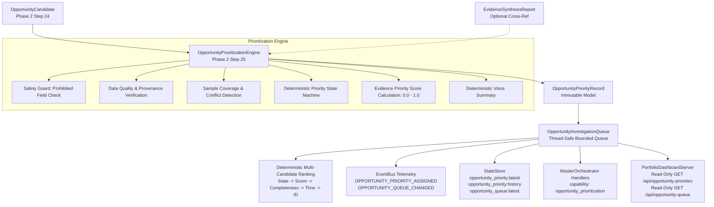

# KAISER Phase 2, Step 25 Implementation Report: Evidence-Based Opportunity Prioritization & Investigation Queue Foundation

> **CRITICAL ARCHITECTURAL MANDATE & NON-PRESCRIPTIVE BOUNDARY:**  
> **This system prioritizes candidates for human analytical investigation only. It does not rank trades, predict profitability, or provide execution recommendations.**  
> `Settings.execution_locked` remains permanently `True`. Live trading, broker integration, real-money execution, autonomous order execution, trading recommendations (`BUY`, `SELL`, `HOLD`), entry/exit prices, position sizing, leverage, order routing, and stop-loss/take-profit parameters are strictly prohibited. External repository `JUJU/` is completely untouched.

---

## 1. Objective

The objective of Phase 2, Step 25 is to build a deterministic **Evidence-Based Opportunity Prioritization and Human Investigation Queue** foundation directly on top of Phase 2, Step 24 (`OpportunityCandidate`).

While Step 24 synthesizes evidence into structured opportunity candidate assessments, Step 25 determines:
> *"Which analytical candidates have the strongest evidence completeness and deserve earlier human investigation?"*

Key requirements fulfilled:
- **Human Investigation Priority Only**: Answers which candidate to inspect next, never which trade to execute.
- **Deterministic**: Given identical candidates or candidate groups, prioritization states, completeness scores, and rankings are 100% reproducible.
- **Traceable**: Every prioritization record links directly to source candidate IDs, evidence report IDs, run IDs, provenance records, and quality statuses.
- **Uncertainty- & Quality-Aware**: Data quality status, provenance completeness, sample coverage, and epistemic uncertainties directly govern priority states and deprioritization reasons.
- **Thread-Safe & Bounded Queue**: Investigation queue maintains strictly bounded memory with thread-safe mutations, duplicate handling, and automatic re-ranking.
- **Strictly Non-Prescriptive**: Prohibits any trading recommendations, trade signals, price levels, order sizing, or broker calls.

---

## 2. Architecture & Data Flow



---

## 3. Domain Models & Immutability

All domain models are implemented as frozen dataclasses (`frozen=True`) with tuples for collections:

### `PriorityState` (Enum)
- `NOT_ELIGIBLE`: Candidate is invalidated, malformed, or compromised.
- `INSUFFICIENT_EVIDENCE`: Evidence synthesis is stale, unavailable, or too sparse (< 0.20 completeness).
- `DATA_QUALITY_LIMITED`: Market data quality is degraded or invalid.
- `CONFLICTING_EVIDENCE`: Unresolved conflicting evidence observations detected.
- `REVIEW_REQUIRED`: Sufficient empirical observations exist, but important epistemic uncertainties or limitations require human review.
- `NORMAL_PRIORITY`: Evidence completeness is sufficient for standard investigation queue.
- `HIGHER_REVIEW_PRIORITY`: High evidence completeness across observations, verified provenance, verified reproducibility, clean data quality, and zero conflicts.

### `PriorityVoiceSummary`
Deterministic speech-ready text strictly verified against `FORBIDDEN_VOICE_WORDS`:
- `headline`: Title string (e.g. `"KAISER Investigation Queue: EURUSD 1h"`).
- `priority_speech`: Speech description of assigned priority.
- `reasons_speech`: Concise speech description of key supporting reasons.
- `caveats_speech`: Caveats and non-prescriptive disclaimers.
- `full_speech_script`: Complete script tested against forbidden trading terms.

### `OpportunityPriorityRecord`
Immutable record representing investigation urgency:
- `priority_id`: String identifier (e.g. `prio_<uuid4_hex>`).
- `candidate_id`: Source `OpportunityCandidate` ID.
- `symbol`: Market symbol (e.g. `"EURUSD"`).
- `timeframe`: Observation timeframe (e.g. `"1h"`).
- `investigation_priority`: Integer rank (1 = top priority, 2, 3...).
- `priority_state`: `PriorityState` enum.
- `evidence_completeness`: Raw completeness score from candidate (0.0 to 1.0).
- `evidence_priority_score`: Bounded composite evidence priority score (0.0 to 1.0).
- `data_quality_state`: Data quality status string (`VALID`, `DEGRADED`, `INVALID`, `UNVERIFIED`).
- `provenance_state`: Provenance status string (`AVAILABLE`, `UNVERIFIED`).
- `reproducibility_state`: Reproducibility status string (`AVAILABLE`, `UNVERIFIED`).
- `conflict_state`: Categorical conflict status (`NO_CONFLICTS`, `CONFLICTING_OBSERVATIONS_DETECTED`).
- `uncertainty_state`: Categorical uncertainty status (`NO_UNCERTAINTIES`, `UNCERTAINTIES_PRESENT`).
- `historical_coverage_state`: Coverage classification (`ADEQUATE_COVERAGE`, `MODERATE_COVERAGE`, `SPARSE_COVERAGE`).
- `supporting_evidence_count`: Count of supporting evidence items.
- `conflicting_evidence_count`: Count of conflicting evidence items.
- `missing_evidence_count`: Count of missing evidence items.
- `limitation_count`: Count of methodological limitations.
- `priority_reasons`: Tuple of factual supporting reasons.
- `deprioritization_reasons`: Tuple of factual limiting reasons.
- `source_report_id`: Originating `EvidenceSynthesisReport` ID.
- `source_analysis_run_ids`: Originating `AnalysisRun` IDs.
- `reproducibility_id`: Cryptographic reproducibility fingerprint.
- `generated_at`: UTC epoch timestamp.
- `voice_summary`: `PriorityVoiceSummary`.
- `metadata`: Sanitized auxiliary metadata dictionary.
- `disclaimer`: Strict non-prescriptive disclaimer string.

---

## 4. Deterministic Prioritization Logic & Priority States

The prioritization engine applies a deterministic decision tree without stochasticity:

```
[Input OpportunityCandidate]
        │
        ▼
Is candidate invalidated (is_invalidated or INVALIDATED)?
  ├── YES ──► State = NOT_ELIGIBLE (Score = 0.0)
  └── NO
        │
        ▼
Is data quality DEGRADED or INVALID?
  ├── YES ──► State = DATA_QUALITY_LIMITED
  └── NO
        │
        ▼
Are there any conflicting evidence observations (> 0)?
  ├── YES ──► State = CONFLICTING_EVIDENCE
  └── NO
        │
        ▼
Is evidence unavailable, stale, or score < 0.20?
  ├── YES ──► State = INSUFFICIENT_EVIDENCE
  └── NO
        │
        ▼
Are there uncertainties, limitations, or sparse coverage (< 30 bars)?
  ├── YES ──► State = REVIEW_REQUIRED
  └── NO
        │
        ▼
Is candidate ANALYTICALLY_SUPPORTED, HIGH confidence, provenance AVAILABLE,
reproducibility AVAILABLE, data quality VALID, and completeness >= 0.70?
  ├── YES ──► State = HIGHER_REVIEW_PRIORITY
  └── NO  ──► State = NORMAL_PRIORITY
```

---

## 5. Numeric Score Definition (`evidence_priority_score`)

To strictly prohibit trade profitability claims, `evidence_priority_score` represents **INVESTIGATION EVIDENCE COMPLETENESS ONLY**:
- **Base Component**:
  - `candidate.evidence_completeness_score` (0.0 to 1.0)
- **Bonuses**:
  - `+0.10`: Verified data provenance (`AVAILABLE`)
  - `+0.10`: Verified analysis run reproducibility (`AVAILABLE`)
  - `+0.10`: Verified clean data quality (`VALID`)
  - `+0.05`: Zero unresolved conflicts
- **Penalties**:
  - `-0.30`: Conflicting evidence observations present
  - `-0.25`: Degraded or invalid market data quality
  - `-0.10`: Epistemic uncertainties present
  - `-0.05`: Methodological limitations documented
  - `-0.10`: Historical sample coverage is sparse (< 30 bars)
- **Bounds & Edge Cases**:
  - Clamped strictly to `[0.0, 1.0]` and rounded to 4 decimal places.
  - If state is `NOT_ELIGIBLE`, score is fixed to `0.0`.
  - Exact zero values (`0.0`) are preserved.
  - `NaN`, `Infinity`, and `-Infinity` are rejected with `ValidationError`.

---

## 6. Investigation Queue Behavior & Tie-Breaking Rules

`OpportunityInvestigationQueue` provides thread-safe in-memory queue management:
- **Thread Safety**: Protected by `threading.RLock()`.
- **Bounded Capacity**: Clamped to `max_capacity` (default 100, max 1,000). When full, lower-ranking candidates are dropped or evicted.
- **Duplicate Safe**: Keyed by `candidate_id`. Re-adding an existing candidate updates the candidate and triggers re-ranking.
- **Deterministic Multi-Candidate Ranking**:
  Ordering comparator:
  1. PriorityState rank:
     - `HIGHER_REVIEW_PRIORITY`: 6
     - `NORMAL_PRIORITY`: 5
     - `REVIEW_REQUIRED`: 4
     - `CONFLICTING_EVIDENCE`: 3
     - `DATA_QUALITY_LIMITED`: 2
     - `INSUFFICIENT_EVIDENCE`: 1
     - `NOT_ELIGIBLE`: 0
  2. `evidence_priority_score` (descending)
  3. `evidence_completeness` (descending)
  4. `generated_at` (descending)
  5. `candidate_id` (ascending — strictly deterministic tie-breaker)
- **Investigation Priority Assignment**:
  Sequential integer ranks (`investigation_priority`: 1, 2, 3...) assigned to sorted queue items.
- **Operations Supported**:
  `add_candidate`, `update_candidate`, `remove_candidate`, `get_next` (peek top), `list_queue`, `invalidate_candidate`, `clear`, `size`, `get`.

---

## 7. Safety Restrictions & Prohibited Fields

### Prohibited Trade Fields
`validate_no_prohibited_fields` recursively scans all incoming payloads and rejects:
- `action`, `side`, `order`, `entry`, `exit`, `quantity`, `position_size`, `leverage`, `stop_loss`, `take_profit`, `broker_order`, `execution_instruction`, `target_price`, `entry_price`, `exit_price`, `order_type`, `trade_recommendation`, `trade_signal`, `buy_signal`, `sell_signal`, `expected_profit`, `profit_probability`, `trade_probability`, `win_rate`, `predicted_pnl`.

### Forbidden Voice Words
Voice summaries are checked against `FORBIDDEN_VOICE_WORDS`:
- `buy`, `sell`, `hold`, `enter`, `exit`, `long`, `short`, `position size`, `leverage`, `order`, `execute`, `profit`, `profitable`, `guaranteed`.

---

## 8. Handlers, EventBus & StateStore Integration

### MasterOrchestrator Handlers (`capability="opportunity_prioritization"`)
1. `prioritize_opportunity`: Prioritizes a single candidate and optionally enqueues it.
2. `prioritize_opportunity_group`: Evaluates and deterministically ranks multiple candidates.
3. `get_opportunity_priority`: Retrieves priority record by `priority_id` or `candidate_id`.
4. `list_opportunity_priorities`: Queries historical priority records with pagination and state filtering.
5. `get_investigation_queue`: Returns the active investigation queue in priority order.
6. `validate_opportunity_priority`: Verifies eligibility and deprioritization reasons.

### EventBus Events
- `EventType.OPPORTUNITY_PRIORITY_ASSIGNED`: Published when a candidate is prioritized.
- `EventType.OPPORTUNITY_PRIORITY_UPDATED`: Published on priority update.
- `EventType.OPPORTUNITY_QUEUE_CHANGED`: Published when queue size or top candidate changes.
- `EventType.OPPORTUNITY_PRIORITY_FAILED`: Published on validation failure.
*All event payloads are sanitized: zero secrets, zero audio, zero file paths.*

### StateStore Keys
- `opportunity_priority:latest`: Dictionary of the most recent priority record.
- `opportunity_priority:history`: Bounded FIFO list of priority records.
- `opportunity_queue:latest`: Snapshot of active investigation queue.

---

## 9. Dashboard Read-Only Endpoints

Integrated into `PortfolioDashboardServer` (loopback only: `127.0.0.1`):
- `GET /api/opportunity-priorities`: Lists historical priority records with pagination (`limit`, `offset`) and `state` filtering.
- `GET /api/opportunity-priorities/<priority_id>`: Retrieves priority details.
- `GET /api/opportunity-queue`: Lists active investigation queue in ranked order.
- **Security & Constraints**:
  - Loopback-only binding (`127.0.0.1`, `localhost`).
  - `HEAD` supported (headers only, zero response body).
  - Mutating methods (`POST`, `PUT`, `DELETE`, `PATCH`) return `405 Method Not Allowed`.
  - Path traversal attempts (`..`) return `400 Bad Request`.
  - Safe ID pattern validation (`^[A-Za-z0-9_\-\.]+$`).

---

## 10. Test Execution Results

### Focused Step 25 Test Suite
File: `tests/test_phase_2_step_25_opportunity_prioritization.py`  
Command: `python -m pytest tests/test_phase_2_step_25_opportunity_prioritization.py -v`  
**Result: 38 passed in 2.94s**

Coverage summary:
- Valid candidate prioritization (HIGHER_REVIEW_PRIORITY / NORMAL_PRIORITY)
- Insufficient evidence state
- Invalid / invalidated candidate (NOT_ELIGIBLE)
- Stale / invalid data quality (DATA_QUALITY_LIMITED)
- Missing provenance & reproducibility handling
- Conflicting evidence detection (CONFLICTING_EVIDENCE)
- Uncertainty handling (REVIEW_REQUIRED)
- Limitation preservation
- Deterministic priority state & numeric score
- Repeated identical input yields identical output
- Multi-candidate ordering & ranking
- Stable tie-breaking logic
- Queue insertion, update, duplicate handling, invalidation, retention, and thread concurrency
- Traceability & reason population
- NaN/Infinity rejection & zero preservation
- Prohibited recommendation field rejection
- EventBus lifecycle events & StateStore persistence
- MasterOrchestrator handler registration and execution
- Dashboard GET, HEAD, 405 on POST, and path traversal rejection
- Execution lock & JUJU isolation

### Full Regression Suite
Command: `python -m pytest -q`  
**Result: 1,063 passed in 61.75s (0 failures, 0 errors)**

### Startup Verification
Command: `python run.py`  
**Result: Exit Code 0**
```
======================================================================
  KAISER — AI TRADING DESK FOUNDATION
======================================================================
  Version:            0.1.0
  Environment:        development
  Voice Interface:    ready
  Market Monitor:     ready
  Provenance Tracker: ready
  Analysis Registry:  ready (1000 max runs)
  Comparison Engine:  ready (500 comparisons cached)
  Evidence Engine:    ready (100 reports cached)
  Opportunity Engine: ready (100 candidates cached)
  Prioritization Engine: ready (100 records cached)
  Investigation Queue:   ready (100 queue capacity)
  Technical Engine:   ready
  Historical Loader:  ready (mock_historical_provider)
  Replay Engine:      ready
  Backtest Engine:    ready (sma_crossover)
  Walk-Forward:       ready
  Robustness:         ready
  Risk Monitor:       ready
  Reporting Service:  ready
  Dashboard UI:       ready (offline)
  Trading Engine:     NOT INITIALIZED
  Execution Status:   LOCKED
======================================================================
```

### Dashboard Loopback Verification
Tested on `http://127.0.0.1:8091`:
- `GET /api/opportunity-priorities` returned `200 OK` with keys: `['status', 'read_only', 'execution_locked', 'count', 'limit', 'offset', 'priorities']`
- `GET /api/opportunity-queue` returned `200 OK` with keys: `['status', 'read_only', 'execution_locked', 'queue_size', 'count', 'limit', 'offset', 'queue']`
- Clean server shutdown executed with no socket leaks.

---

## 11. Safety Verification Summary

| Invariant | Status | Verification Detail |
|---|---|---|
| `Settings.execution_locked` | LOCKED (`True`) | Verified across config, bootstrap, and test suites |
| Live trading / Broker integration | ABSENT | Zero broker modules imported or instantiated |
| Autonomous order execution | PROHIBITED | No autonomous order routing or execution code |
| Trading recommendations | PROHIBITED | No BUY/SELL/HOLD, entry/exit prices, or leverage generated |
| Prohibited payload fields | STRICTLY REJECTED | `validate_no_prohibited_fields` raises `ValidationError` |
| Voice summary safety | ENFORCED | Verified against `FORBIDDEN_VOICE_WORDS` |
| Numerical integrity | ENFORCED | Rejects `NaN`, `Infinity`, `-Infinity`; genuinely preserves `0.0` |
| External `JUJU/` isolation | UNTOUCHED | Zero files modified or added in `JUJU/` |
| Memory bounds | ENFORCED | StateStore, queue, and engine histories clamped to strict bounds |

---

## 12. Known Limitations

1. **Non-Predictive Scope**: Investigation prioritization ranks empirical completeness for human analyst review only. It does not predict market direction or profitability.
2. **In-Memory Queue**: The active queue is bounded in memory (default 100 entries). Persisted across runs via StateStore; permanent relational table persistence will be handled in future storage phases.
3. **Upstream Evidence Dependency**: Candidates with missing or stale upstream evidence are categorized as `INSUFFICIENT_EVIDENCE` or `NOT_ELIGIBLE`.

---

## 13. Git Commit Information

- **Implementation Commit Hash**: `19346f2`
- **Branch**: `master`
- **Commit Message**: `feat(analysis): Phase 2 Step 25 - Evidence-Based Opportunity Prioritization & Investigation Queue Foundation`
